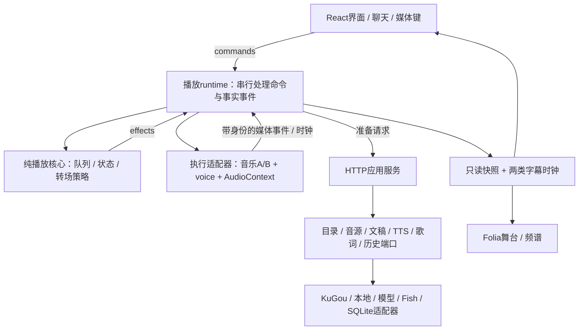

# Claudio 统一实施方案：播放核心重建、字幕与 DJ 曲间衔接

> 状态：实施进行中。用户已授权Opus实施、Fable与Codex决策；每个通过检查的切片单独提交。运行验收按第9节台账记录，未通过项不宣称完成。
>
> 修订日期：2026-10-16（Pacific/Auckland）。本文件是当前产品目标、架构取舍、实施顺序、验收和进度的**唯一权威入口**。本次已撤销“最小改动实施基线”，转为按职责重建核心；此前的 Session 主线和旧重构顺序均不再生效。
>
> 代码说明已有行为；本文件规定目标。研究材料、历史方案和模型回复只作证据，不另行分配任务。原有业务改动已保存为独立checkpoint；后续在codex/playback-core-rebuild分支按切片实施。

## 1. 现在要解决什么

用户明确的成功标准是：**“日常使用，那个字幕和电台dj，就是切换歌的时候的衔接。”**

产品目标据此改为：打开后能顺畅听歌，歌词/字幕清楚，DJ 在合适的曲间窗口连接前后两首；暂停、跳歌、缓冲或生成失败时不出现过期声音和错误字幕。

“字幕”暂分别覆盖**歌曲歌词**和**DJ 口播字幕**，不擅自认定只要其中一种。具体常用设备、是否锁屏/关窗继续播放、曲库是否必须 KuGou、是否必须 Fish 或特定人设仍未知。源码当前使用它们，只能说明已有集成资产，不能当成用户不可改变的要求。

**当前决策：重建 Claudio 的播放领域核心、浏览器音频执行层和服务端准备/播放事实合同；保留 React/Vite/TypeScript、Node/Express/SQLite 及可独立复用的产品能力。现有 App/useAudio/Player 不再作为必须维持的编排骨架。** 保留工具链的理由是当前缺口集中在所有权、身份和副作用合同，没有证据表明换框架或数据库会解决这些问题；不再以最小 diff 作为选择依据。

用户已明确接受大改，要求“能复用就复用”“鲁棒性、高内聚低耦合”。本方案据此允许替换整个核心编排、改 API/数据模型和建立真实模块边界。旧版本只是行为、数据和回退参照；不要求先修完旧编排再重建。复用按模块能力与许可选择，旧实现和竞品整仓均不享有默认保留权。

本轮是架构决策与实施方案修订：真实 Fable 独立审查后与 Codex 交叉讨论。尚未改业务代码、迁移运行数据或完成浏览器试听；更早的 Opus 意见作为历史证据，不能冒称它已批准本次新架构。

### 已决定与待决定

| 层次 | 本次结果 |
| --- | --- |
| 已确认目标 | 个人日常使用；字幕；切歌时 DJ 衔接 |
| 已决定优先级 | 播放与字幕先行；短口播可关闭；迟到口播放弃；手动暂停/跳歌优先 |
| 已决定架构 | 框架无关的播放核心 + 可替换执行适配器 + 模块化服务端；浏览器端唯一执行者，音乐 A/B 与 voice 统一资源归属 |
| 复用方向 | Aurio 混音拓扑、SUB/WAVE 准备跟踪、MA 窗口预算、Folia 歌词解析/渲染；接入自有合同，允许修改源码 |
| 待实证选择 | 目标设备后台能力、转场默认听感、歌词覆盖/对齐；若执行端不满足再重开宿主选择，不把未测竞品当已证明更稳 |
| 本期不要求 | 会话审批/锁定编辑 UI、三表 Session 执行协议、分布式租约、多设备、公共广播、向量推荐、全模式视觉 |

## 2. 市场对照：有重叠产品，能力必须分开比较

截至 2026-10-16。下表“有”表示官方文档或源码支持，并非本次已安装试听；“未确认”不等于不存在。消费产品公开功能不能直接当成可供 Claudio 调用的 SDK。没有用星数、代码量或厂商宣传给可靠性打分。

| 产品 / 组合 | 与日常听歌直接相关的能力 | 字幕与衔接边界 | 可吸收的机制 / 比较用途 |
| --- | --- | --- | --- |
| [Spotify DJ](https://support.spotify.com/us/article/dj/) | 自动选曲与声音讲解；可提出收听方向 | NZ 有 DJ 开放记录；2026 Talk 多轮 beta 已核实三国不含 NZ。未确认可自定义中文主持、导出逐字口播字幕或调用 DJ API | 自动开听、少操作、改变方向即可继续的消费体验基准；需要账号实际验证 |
| [Apple Music](https://support.apple.com/en-us/105067) | AutoMix 动态过渡、Crossfade；歌曲歌词及部分歌词翻译 | AutoMix 是混音，不是已证实的主持口播；订阅/终端/曲目有限制，个人上传和顺序专辑等不保证动态衔接 | 歌词可读性与歌曲连接的体验基准；不假定 MusicKit 开放内部混音引擎 |
| [网易云私人 DJ](https://www.hkexnews.hk/listedco/listconews/sehk/2024/0229/2024022900400_c.pdf)、[QQ / 酷狗 AI Agent](https://ir.tencentmusic.com/2026-08-11-Tencent-Music-Entertainment-Group-Announces-Second-Quarter-2026-Unaudited-Financial-Results) | 网易披露推荐、背景介绍和解说；腾讯披露按即时需求生成歌单 | 本次一手材料不足确认当前地区/入口、口播形式与同步字幕，不能把三家标成同一能力 | 中文现成体验的候选；以用户账号试用补证，不能据官方材料缺细节判不存在 |
| [Aurio](https://github.com/baogutang/aurio) | 个人 AI 电台、曲间 TTS、歌词、多来源；源码有节目预备与双音乐元素 | 高度重叠，但本次没有试听中文声线、歌词覆盖率、暂停语义或账号音源；不是已证明可直接替换 | 提前准备、独立音乐/旁白通道、生成失败的规则降级；适合作完整体验对照 |
| [Music Assistant AI Radio](https://www.music-assistant.io/plugins/ai-radio/) | 2.10.6 已有 Alpha AI Radio / queue DJ；Party 插件可显示 LRC | 需 AI/TTS 引擎及播放设备。人声起点预算、口播尾部叠前奏的具体实现仅在更新主分支确认，不能算到2.10.6；字幕与混音联合效果未验 | 按播放器能力选择转场、语音预算、无前奏/无时间信息时顺序播放 |
| [Folia](https://github.com/chthollyphile/folia-major) | 沉浸歌词、双 deck automix、Web Audio增益、媒体键、桌面和Web代码 | 未发现现成的 Claudio式TTS调度；Stage外部状态不是完整音频时钟/旁白控制协议；整仓集成和舞台复用是不同工作 | 歌词渲染、歌曲显示身份与发声deck分离、增益曲线；两种融合路线分别验证 |
| [SUB/WAVE](https://github.com/perminder-klair/subwave) | 自有库共享电台流、AI口播、Liquidsoap/Icecast 音频链 | 共享节目流不等于随时暂停/seek的个人播放；需要额外服务与本地库 | 依据前奏/首人声限制稿件、整句缩短或放弃、音乐/voice独立增益 |
| [Duetto](https://github.com/avisforevelyn/Duetto) | 歌词引用聊天、歌曲记忆、网易云/URL、模型播放动作 | 音频分析失败会退回歌词文本；本次未确认完整曲间 TTS 混音 | 当前歌词与歌曲上下文绑定，生成失败不夸大“听过音乐”；不是已验证的转场替代品 |
| [AutoDJ](https://github.com/blindndangerous/AutoDJ) | 本地库连续选曲、队列、歌词、voice liners | 模型下载/索引有成本；liner 不自动等于即时有上下文的主持口播 | 准备下一项时不提前出队，实际开始后再提交 |
| [Navidrome + Feishin](https://github.com/jeffvli/feishin) + [AudioMuse](https://navidrome.org/docs/usage/integration/audiomuse/) | 曲库/歌词、AutoDJ续曲、音频相似度与语义生成歌单 | 三者分工可组合；语义歌词搜索不是字幕渲染，续曲不是口播。版本/插件要匹配；新增强歌词字段不保证已在发布包端到端可用 | 音乐资产服务与播放执行分离；以后真有本地库发现需要时再引入分析 |
| [Plexamp](https://www.plex.tv/plexamp/) | 个人库、预缓存、Sweet Fades、声学路径、歌词 | Guest DJ 已确认插入/延展队列，未确认主持口播；歌词等有 Pass 条件。TIDAL旧集成已终止 | 预缓存、响度、淡变、弱化每首之间的操作负担；作为聆听连贯性参照 |
| [Roon](https://help.roonlabs.com/portal/en/kb/articles/faq-what-s-radio-and-how-does-it-work)、[Lyrion](https://lyrion.org/getting-started/) | 个人音乐系统、连续选曲与设备播放；Roon有Radio/Focus/ARC，Lyrion有规则/动态队列 | 本次未证实所核查路径提供可配置DJ口播字幕；设备/服务器/订阅或插件构成不同成本 | 音频执行与控制界面分离、真实播放器位置；不能仅换曲库后端就宣称转场完成 |

完整事实卡、固定提交、限制与检索轨迹见本文件末尾证据索引。最接近不等于最适合：要用相同音源、同一设备和相同 A→DJ→B 场景试听，才能比较字幕、听感与维护负担。

## 3. 技术栈是否合适：分层裁决

| 层 | 当前判断与实施选择 | 何时重开决策 |
| --- | --- | --- |
| React / Vite / TypeScript | 保留。没有运行证据显示它们限制字幕或混音；把高频媒体位置和调度从 App 的界面状态中分离。框架相同不代表竞品模块能直接移植 | 实测渲染负载、包体或维护困难确由该层造成 |
| Express / Node / SQLite | 保留运行技术，重划 transport/application/ports/adapters 边界。Catalog/DTO、TTS缓存、选曲规则保留能力，重做准备/历史和供应商身份合同；允许加法迁移 | 明确多用户、远程执行或数据库瓶颈；保留数据资产不等于冻结旧schema |
| 音频执行 | 重建框架无关的核心与浏览器driver，替换分散hooks/effects。唯一coordinator、音乐A/B和voice独立gain；AudioContext时间排包络，实际媒体事件确认状态 | 目标设备实际后台/锁屏、DRM或音频输出能力不满足时，再比较 native/服务端执行 |
| 歌曲歌词 | 新增录音身份匹配、歌词资产与渲染。先可靠行级，再用原生词时间提升精度；KuGou KRC、本地 LRC 按实际来源接入 | 真实曲库命中率/对齐质量不能满足时换数据来源，而不是只换动画 |
| DJ 字幕 | 使用 voice 媒体时钟；先去掉固定假时间标签。无对齐数据时显示整句/全文，估算必须明确标注 | 实测用户需要逐字后，再比较 TTS 原生时间戳、句段合成或对齐服务 |
| Folia | 保留歌词、双 deck、display/raw 分层等资产的价值；独立验证最小渲染入口与完整宿主接口，不合并两个 package.json | 小舞台必须引入全账号/曲库/播放器，或完整宿主能明显减少已验证工作时重新取舍 |
| Electron | 暂不加壳。可复用 Web UI，但 renderer 仍需正确音频状态与生命周期 | 真实需要托盘、关窗继续或桌面集成；定义声音 owner 后做目标 OS 验证 |
| Tauri | 暂不迁移。可保留 React，Node 后端也可 sidecar；引入 Rust/系统 WebView/打包验证是新增工作 | 实测分发或资源收益值得付出适配成本，不凭“轻量”标签判断 |
| 外部音乐后端 | 区分目录服务与音频执行器。Navidrome/OpenSubsonic 供库不等于替浏览器混音；MA/Mopidy 等须确认声音实际输出位置与 voice 控制 | 既有服务器/音箱、多设备或现成执行器确实能减少总体工作 |

官方边界：[Web Audio](https://www.w3.org/TR/webaudio-1.1/#MediaElementAudioSourceNode)、[Media Session](https://w3c.github.io/mediasession/)、[Electron 进程模型](https://www.electronjs.org/docs/latest/tutorial/process-model)、[Tauri 进程模型](https://v2.tauri.app/concept/process-model/)、[Node sidecar](https://v2.tauri.app/learn/sidecar-nodejs/)。增益按音频时钟调度可去掉对动画帧的依赖，但不能承诺 OS/AudioContext 从不挂起。MusicKit 的目录/播放能力也不等于开放 AutoMix、PCM 或第三方 TTS 混音；本轮这些边界仍未验证。

### 3.1 路线裁决与反证条件

| 路线 | 最强收益 | 本次裁决与重开条件 |
| --- | --- | --- |
| 继续修补现有 App/hooks | 单个缺陷可局部修复，短期接线少 | 不作为目标架构。身份、取消、队列提交与图所有权跨多个入口；必须改变权限和合同，不能仅把函数搬成更多hooks |
| **重建 Claudio 核心，复用独立能力** | 可用同一套行为合同约束音频、来源、生成与舞台；保留产品资产 | **采用**。核心与driver新建，旧编排切换后删除；并不承诺重建成本低于任何宿主，接受为边界清晰支付迁移成本 |
| Folia 为完整宿主 | 歌词、双deck、媒体图与来源体系已有 | 未选为首个执行宿主；内部可加旁白端口，不因缺公开API或AGPL就判不可用。若相同输入验证完整DJ/取消/身份合同并显示较少维护负担，可改选；不要求必用Electron |
| Aurio 为完整宿主 | 已有节目准备、混音和连续节目模型 | 未整仓迁入。live墙钟与本地暂停语义不同，tape另有回放；需迁移来源/偏好/文稿能力。无KuGou不意味着必须放弃KuGou，JS服务端也不意味着前端没有TS |
| 服务端主导个人节目或 MA/SUB/WAVE 音频执行 | 便于远程播放器、共享队列或统一输出 | 技术上可行；个人可暂停节目仍须媒体回执，不能从计划墙钟推断播放。当前不引入网络命令闭环与新运行服务；明确远程设备/共享节目需求后重开 |
| 全量更换语言、UI框架、数据库 | 可以同时清理全部实现 | 当前没有证据表明这些工具是瓶颈；重写现有独立资产会扩大无关迁移面。若实测约束落在这些层，再按证据替换 |

架构决策以当前产品语义为依据；“有时间线”不等于必须用服务端墙钟推进。**计划描述意图，执行状态描述已发生事实。** 当前选择端侧媒体驱动的执行核心；服务端供候选、资产、持久化与观察投影，不成为第二个自动下一首执行者。未来若改成直播或远程扬声器，需明确变更这条产品语义。

## 4. 当前代码与用户体验之间的具体缺口

基线：Claudio HEAD `03ae25814a747d5228866542668c7bf096fa535c` **加当前未提交工作树**；Folia `a57803d09283d417497a4b951834c00d7b6f5a3c`，package `0.7.19`。版本不是“npm 最新版”声明。

| 源码事实 | 实施含义 |
| --- | --- |
| [App.tsx:546](src/App.tsx#L546) 在结束后取下一首，单音乐元素换 src；无队列时才请求 radio pick | 要准备下一首来源与媒体，不能等 ended 才走所有网络步骤；实际静音时长尚未测量 |
| [App.tsx:330](src/App.tsx#L330)、[469](src/App.tsx#L469)：首曲0、后续3000ms墙钟门槛；迟到 voiceUrl 可立即播 | 去掉固定3秒作为唯一决策；窗口关闭后不补播迟到口播；不能用 play 请求事件当真实开声 |
| [App.tsx:409](src/App.tsx#L409)：prepared 只有文字/URL；getToday 在接后续 narration 前被 await | URL返回不等于已缓冲可播；旁白准备不应被统计读取阻挡；错误路径需分别验收 |
| [App.tsx:200](src/App.tsx#L200)：rAF 将音乐压到用户音量25%，280ms淡下/900ms恢复 | 转场增益改为音频时钟；后台可能停在最后音量是待复现风险，不报成已测故障 |
| [useAudio.ts:84](src/hooks/useAudio.ts#L84)、[Player.tsx:307](src/components/Player.tsx#L307)：音乐暂停不停止voice；voice面板按钮绕过isSpeaking | 用户控制、实际媒体事件与ducking必须走同一协调器 |
| [Player.tsx:95](src/components/Player.tsx#L95)、[452](src/components/Player.tsx#L452)：按时长均分字符；行时间固定5+4i；没有歌曲歌词API | 两类字幕分别补；不能把近似进度包装成原生逐字对齐 |
| [index.ts:330](server/index.ts#L330)、[510](server/index.ts#L510)：radio/next、chat返回选曲就recordPlay | 先分离候选准备与实际播放记录，才能安全提前请求；不能只改调用时机 |
| [index.ts:259](server/index.ts#L259)：远端失败可回退本地文件 | catalog ID/hash不单独证明实际录音；回退更换录音须更新revision并清旧歌词 |
| [Player.tsx:190](src/components/Player.tsx#L190)：组件创建音乐WebAudio图 | 新混音器接管时明确迁移图所有权，不能对同一media重复createMediaElementSource；纯舞台实验保持原Player挂载 |
| [now.ts](server/now.ts)：后端内存投影；界面也有各自局部状态 | /api/now不升级为第二时钟或命令总线；实际媒体状态是唯一依据 |

已有局部 runId、UI songId 校验和TTS缓存是可参考资产；新核心会替换分散保护并迁移有效缓存策略，不能说当前完全没有取消保护。以上潜在竞态尚未在真实浏览器复现，不能据静态路径编造故障次数。

### 4.1 为什么需要改变底座

1. **写权限分散**：App拥有队列/生成/时机，useAudio拥有媒体和局部状态，Player又创建输出图、直接操作voice。重构后只允许执行适配器操作媒体，只有核心推进队列；拆文件而保留多个写者不算完成。
2. **身份无法贯穿**：songId不能区分同曲两次入队、同条目重试或实际录音变更；TrackRecord的filePath还承载provider URI。新增来源、歌词和双deck都会重复面对该缺口。
3. **生成与播放事实混淆**：选中就写played，生成新台词按songId回填latest，预取因而改变历史。必须换语义合同，而不只是提前发请求。
4. **生命周期不完整**：停止voice没有显式结束等待Promise；LLM/TTS的Promise.race超时不等于取消网络。应统一取消、终态、超时/重试预算和过期结果拒绝。
5. **测试锁定实现**：当前11个前端测试文件主要是源码文本断言，useAudio测试还锁定play前乐观playing。必须改为状态转换、HTTP/存储和真实媒体行为测试；已有后端DTO、临时SQLite等行为测试继续保留。

这五项支持核心重建。已有工具库、选曲规则、人设/fewshot、校验器、传输协议、缓存和视觉资产可以迁入新边界；“保留能力”不等于原封不动保留其副作用。

## 5. 借鉴什么，怎样融入

| 借鉴项 | 具体来源 | Claudio 落点与限制 |
| --- | --- | --- |
| 双音乐deck、独立voice与music duck bus | [Aurio audioGraph](https://github.com/baogutang/aurio/blob/959fd7743d8d2cef142141f1b4be65c8b91bb1dc/web/src/lib/audioGraph.ts) | 在新browser driver中建立一个音频owner，替换useAudio/App/Player的控制权限；先交付完整gain生命周期与取消，不一起搬人声效果、日历、广播系统；真实接线/回归成本未测 |
| 提前准备、无人收听不无界生成 | [Aurio station](https://github.com/baogutang/aurio/blob/959fd7743d8d2cef142141f1b4be65c8b91bb1dc/server/playout/station.js) | 只准备一个已确定下一项；资源/URL/TTS分别有状态，用户改队列就失效；先解决现有选曲写历史的副作用 |
| 根据前奏限制口播 | [SUB/WAVE enqueue](https://github.com/perminder-klair/subwave/blob/b5d1c4c159d5146239a9a933d36397a681fd1039/controller/src/broadcast/dj-agent/enqueue.ts) | 生成前给时间预算；合成后按实际时长复核。超长改用完整短稿或放弃，不能任意截断音频里的半句话 |
| 只有条件足够才叠前奏 | [MA rendering](https://github.com/music-assistant/server/blob/ee26f6cc29ec904b9608de35c4b9c078b23df94a/music_assistant/providers/ai_radio/rendering.py#L593) | 已核实公式是 `min(人声起点−0.4s, 口播时长−1s)`、最少1.5s重叠；这是上游主分支参数参考，不是Claudio验收结论或通用常数 |
| 无人声数据时降级 | 同上；Aurio cue分析 | 同步歌词第一演唱行也可能偏移；静音检测/响度分析不能代替人声检测。未知则用短顺序口播或不说，不猜可用前奏 |
| 实际发声与画面显示身份分开 | [Folia store](https://github.com/chthollyphile/folia-major/blob/a57803d09283d417497a4b951834c00d7b6f5a3c/src/stores/usePlaybackStore.ts)、[crossfade graph](https://github.com/chthollyphile/folia-major/blob/a57803d09283d417497a4b951834c00d7b6f5a3c/src/services/automix/crossfadeGraph.ts) | A/B重叠时显式选择displayItem，不能把A标题配B进度；中断取消既有gain曲线再恢复 |
| 按实际媒体取词和分级展示 | Folia KuGou provider / KRC parser，Feishin歌词组件 | 保留来源/版本/offset；行级与词级分开；KRC不能塞入默认QRC字段。当前源是KuGou时验证hash链，本地文件用匹配LRC；不强制迁库 |
| 准备与真正消费分开 | [AutoDJ player](https://github.com/blindndangerous/AutoDJ/blob/7284d36f8fa5b6ea8336bc14895adb8dc5b1a467/src/autodj/player.py#L1073) | 准备时peek；实际开始才提交出队/历史；取消准备不损失用户队列 |

源码许可按固定版本文件另行核对：Aurio/SUB-WAVE根许可MIT，Folia为AGPL-3.0。这里不把MIT写成无义务，也不把AGPL写成非商业许可；是否复用源码、改宿主或只参考机制需在实际集成diff中记录。iframe不自动决定许可适用性。本轮没有复制这些项目的业务代码。

### 5.1 开源竞品可以怎样真正复用（本轮补充）

用户追问：「那些竞品，如果是开源的，我能也融合进来吗？」答案是可以，**源码移植、窄逻辑适配和独立服务接入都可选**。此前“借鉴”不是禁止使用原代码；已有独立模块无需因为来自另一产品而重新发明。保持Claudio唯一播放/队列主控，不把几个完整播放器同时放进应用。

下表按已经检查的固定提交与文件许可说明工程选项；“可移植”仍需接线与回归，不等于已经集成。它细化现有R阶段，不新增另一份排期。

| 来源与根/目标许可 | 可融合的具体部分 | 本方案的采用方式 |
| --- | --- | --- |
| **Aurio / MIT** | `web/src/lib/audioGraph.ts`，没有import，A/B音乐gain、共享duck bus、独立voice gain及crossfade曲线 | **第一批源码复用候选，放入R2**。适配为Claudio的音频模块，迁移现有Player图归属；补初始化失败、释放/重建与过期曲线取消。它原来是全局单例、无dispose，不能与原图直接并挂；压缩器不当作无削波保证 |
| **SUB/WAVE / MIT** | `controller/src/broadcast/queue/intro-render.ts` 的单次TTS生成跟踪；enqueue的cue身份与下一曲绑定 | **第一批窄模块候选，放入R2**。适配稳定准备项ID；超时只停止等待，不取消生成，迟到结果仍须epoch校验。root与app/LICENSE均MIT但署名不同，按实际复制文件保留声明 |
| **SUB/WAVE / MIT** | `controller/src/llm/internal/prompts/intro-budget.ts` 的完整句缩短/放弃策略 | **适配到中文，R3按真实时长启用**。原代码按空白词数、英文标点、2.5 words/sec估算；中文无空格会严重低估。保留机制，改中文句界并以合成后真实时长复核；未知前奏不照搬其不约束策略 |
| **Music Assistant / Apache-2.0** | `post_window.py` 的歌词人声窗口判断、`rendering.py` 的时长预算与失败降级 | **R3借算法或移植窄函数**，Python→TypeScript也记录来源与改动。`VoiceOverFade`依赖FFmpeg/PCM/队列运行时，不能直接import浏览器；不引入整个MA当第二播放主控。相关前奏实现仅在已固定主分支确认 |
| **Folia / AGPL-3.0** | 歌词parser/worker、`WebLyricSource`与单模式renderer | **R4可以实际裁剪/改造上游代码**，并非只能看思路。派生代码落在独立固定提交的Folia-stage源码仓/checkout，保留AGPL并独立构建；Claudio只保留stage adapter与版本清单。专用入口、适配只读时钟；歌曲/旁白仍由Claudio发声。整应用和automix不是本批依赖；iframe用于运行隔离，不自动解决许可证问题 |
| **Duetto / MIT** | 歌词引用→带歌曲上下文的聊天交互 | 后置。可以移植交互，但全局React/window/网易云状态需拆；其当前LRC parser丢小数秒，不用于精准字幕。字体等资源另核其许可 |
| **AutoDJ / AGPL-3.0-or-later** | 准备时peek、开始时commit、过期准备归还的合同 | 当前只借机制与测试场景。Python/音频分析依赖重；原soft-refresh允许旧fallback先播，不符合本方案打断优先。历史MIT版本不能替当前提交授权，模型权重也另有许可 |
| **Navidrome / GPL v3；AudioMuse-AI / AGPL-3.0-only** | 曲库/流/歌词接口，或相似歌曲与语义候选 | 真有库管理/选曲分析需要时作为**独立服务**接入；分析选曲不是主持混音。现在不为字幕和转场先引入整套扫描、数据库与模型服务 |
| **Feishin / GPL-3.0-only** | 歌词cue适配、逐行/逐字呈现交互 | 后置参考或另行裁剪。其组件依赖自身player/store/React Query/IPC，不是现成歌词SDK；不嵌入另一个完整播放器 |

组合关系是：**Claudio协调用户操作与队列 → SUB/WAVE式准备跟踪 → 有可信时序时用MA式窗口与中文口播预算 → Aurio式音频图发声 → Claudio/Folia显示对应字幕。** 每一项都消费同一item/source/epoch；多个项目不各自保留一套自动下一首。MA预算与SUB/WAVE截句各有职责，不叠加两个相互竞争的调度器。

**个人自用与后续提供给别人是不同情形。** MIT/Apache允许按其条款修改复用；复制部分保留版权和许可，Apache分发还需修改标记及相关NOTICE。GPL/AGPL也允许私人修改运行，不能理解成“不可融合”。AGPL修改版的远程交互有第13节对应源码要求；对外提供源码或安装包也要按适用条款处理。Claudio原仓库公开、存在Pages工作流，不意味着尚未push的本地修改已被分发。未来结合产物的许可范围需要按实际代码/交付物判断，不能将第三方文件直接改标Apache，也不能仅凭独立目录、HTTP或iframe宣布豁免。依据：[MIT原文](https://opensource.org/license/mit)、[Apache第4节](https://www.apache.org/licenses/LICENSE-2.0)、[AGPL第2/5/6/13节](https://opensource.org/license/agpl-3-0)、[GNU私人修改与AGPL网络交互说明](https://www.gnu.org/licenses/gpl-faq.en.html)。

具体文件及附带资产分别登记：MA的[NOTICE](https://github.com/music-assistant/server/blob/ee26f6cc29ec904b9608de35c4b9c078b23df94a/NOTICE)明确官方构建的服务凭据不随Apache源码授权，第三方使用自己的凭据；这不阻止复用无凭据的小函数。Folia本次固定README/LICENSE只确认AGPL，未发现模型初稿所称的“非商用”限制。代码授权也不自动授权歌曲、歌词资源、模型权重或第三方账户。

实际引入源码时，在该改动中建立相应第三方声明，记录**仓库+commit+文件+许可+本地修改**，按需保留上游测试；无需为尚未采用的项目先复制全套代码/资源。本次仅补充复用决定与证据，没有修改主项目LICENSE或引入业务模块。

补核结果见[音频模块事实](docs/research/product-review-2026-10-16/reuse-audio-facts.md)、[其他项目许可与运行时边界](docs/research/product-review-2026-10-16/reuse-other-facts.md)。在此前开源复用追加轮，真实Fable与Opus分别复核，均支持Aurio图与SUB/WAVE跟踪器作为首批候选；详细归因与未采纳判断记录在[咨询审计](docs/research/product-review-2026-10-16/consultation-audit.md)。

## 6. 目标架构、模块边界与行为合同

### 6.0 模块与依赖方向

目标是**一个代码仓库、一个Web应用与一个Node服务、清楚的内部模块**；不是微服务。新建少量可独立构建的workspace包，以公开exports、TypeScript构建边界和依赖图检查约束导入。构建配置调整属于R1；不要为每个函数都建包，也不因采用workspace而全面移动UI目录。

| 模块 / 目标落点 | 拥有的责任 | 依赖限制与退出条件 |
| --- | --- | --- |
| `packages/contracts` | 按领域拆分的HTTP/持久化/舞台DTO与运行时校验；版本化、可序列化 | 不含DOM、React、Express、DB行或密钥；前后端从同一合同取得类型，拒绝平行复制types |
| `packages/playback-core` | 纯状态转换、队列保留/提交、转场策略、身份与过期判断；`command/event → state + effects` | 不import React/DOM/fetch/SQLite/供应商；clock值作为输入，单元测试无需浏览器与网络。内部把queue/transport/voice/transition分区，避免一个巨大状态函数 |
| `packages/playback-web` | 唯一runtime串行调度；A/B/voice媒体、AudioContext和gain图；资源/监听器生命周期；通过注入端口执行异步effects | 依赖core/contracts；网络、日志、持久化通过端口装配，不反向import src/App。核心不持HTMLAudioElement；UI不拿可写媒体ref。暂停/取消本地立即生效，不等待网络 |
| `src/app`、`src/features/*` | 创建应用runtime、注入HTTP/队列存储适配器；界面/聊天/登录功能；将所有用户操作变为commands | App变为装配与布局；Player只显示。用只读snapshot订阅，时钟/频谱走局部读口，不能每帧驱动全App重渲染 |
| `server/application` | 选曲、准备文稿/语音/歌词、提交播放事实等用例；选择/生成与收听事实分离 | 不import Express请求对象、具体KuGou/Fish或裸数据库；通过窄ports取得能力，不在业务层识别供应商名来控制播放 |
| `server/ports`、`server/adapters` | CatalogSearch、PlaybackResolver、Lyrics、Narration/TTS、History等合同与实现；KuGou、本地、模型、Fish、SQLite、cache | provider能力分开表达，不要求每个源都支持同步/歌词/seek；持久化locator只留adapter。供应商偏好属于选曲策略，不藏在通用DB查询里 |
| `server/http` + composition root | 请求校验、错误映射、路由、SSE输出；将实现注入用例 | HTTP handler不选曲后顺便recordPlay；createApp显式注入配置/服务，import不自动listen/连库/扫描；提供统一close。/api/now是观察投影，不能发起下一首 |
| Folia stage adapter | 把词资产、displayItem、clock映射到固定版本renderer | 只有只读接口。舞台卸载、崩溃、动画掉帧不拥有停止或推进声音的权限 |

采用显式TypeScript状态转换与可注入effects runner；首版无需新增通用事件总线、DI容器、插件市场或全局状态库。React可用[useSyncExternalStore](https://react.dev/reference/react/useSyncExternalStore)订阅稳定、不可变的快照；此处应用层选择不等于React官方要求所有状态外置。包名是明确实现目标，边界须由构建和行为验证，不以目录数量宣称模块化。

**身份与数据合同：**

- `TrackRef { providerId, mediaId }`表示目录媒体；内部`accountRef/authRevision`在服务端区分登录实例，不进入公开DTO。`QueueItemId`表示一次入队，重复同曲必须不同；与catalog主键分开。
- `ResolvedMedia`包含该次解析确认的recording identity、`sourceRevision`、opaque stream handle、expiry和可用能力。签名URL刷新不必改变录音版本，换录音或无法证明相同则重建revision、清词并取消旧cue。新stream handle绑定已解析资源，不能内部静默回退到另一个录音。
- `loadId/epoch`标识一次deck装载，`transitionId`绑定from/to条目，`cueId`绑定文稿/声音版本；每个异步结果、媒体事件、字幕都带对应身份。跨层禁止只传songId。QueueItemId由同一owner的注入ID工厂生成；通常由core分配，电台候选可由应用端口预分配后随入队命令提交，core负责唯一性与接受。服务端prepared/asset ID另设；已登记候选通过GET复用同一准备记录，不二次POST取消重建。暂停/恢复不伪装成一次新入队。
- `PreparedItem`分别表示候选、解析、文稿、TTS资产、metadata、可开始播放；URL成功不等于媒体准备完。TTS时长允许known/unknown并注明测量来源，实际rate另算；未知时长不做叠前奏预算，不制造固定假值。
- `PlaybackSnapshot`有requested/loading/playing/waiting/paused/failed等实际状态、A/B各自时钟、voice时钟、displayItem及版本；`TransitionPlan`表达模式、参与条目、前提、时序锚点和过期条件，不假装计划已经执行。

**服务端必须重建的合同：** 使用明确版本的prepare/resolve/narration/lyrics/started接口，具体路径在R1共享schema中固定。准备接口可以记录候选审计，但不能写played或按trackId更新latest；文稿更新以准备项/资产ID定位。准备按候选/源/文稿/语音返回各阶段结果，不强制等TTS完成才让音乐可播放；迟到结果必须带版本。`started`带稳定幂等键，只有已提交为节目输出且同一load的有效媒体状态确认playing的item发送；不要求这两个条件按固定先后到达，防止已playing的预热deck在被正式启用时漏记。备用deck仅预热时不发送。用户音量为0仍可构成合法播放，应用不声称能测到耳朵是否听见。

历史上报失败不阻塞声音；有界重试、幂等接收与可观察失败，刷新/崩溃下可能丢回执则如实标识，不宣称未经持久化的exactly-once。/api/now包含执行实例与递增序号，拒绝当前实例内旧快照；同origin只开放一个执行者。跨设备/跨浏览器全局排他与租约不在当前保证范围。

**准备资产的存储与失效：** 服务端将prepared的版本、引用和已完成资产元数据存入SQLite，正在进行的网络任务只在内存。完成结果以新版本发布而非无身份覆盖；重启把未完成任务标为interrupted，客户端保留队列意图并按新的preparationId重新准备，旧任务不得复活。已完成缓存可按内容键复用。prepare响应带expiresAt/status；过期返回明确expired，客户端在当前epoch下重新请求，不能继续使用过期stream handle。准备TTL受源expiry与配置上限限制，active准备限当前/下一项；GC清理过期且无活动引用记录，资产缓存单独设容量/保留策略。到期不强行停止已在播放的媒体，但不得再把失效引用当作新load依据。R1固定默认参数和schema，R3测试重启/过期/GC，不将这些参数冒称实测最优。

**异步与资源合同：** 所有可等待operation最终进入completed/cancelled/failed/timed-out之一；取消必须settle。AbortSignal尽力终止网络，但旧结果仍按身份拒绝。请求deadline覆盖响应体读取和重试，错误分可重试/需登录/不可用；只准备有界下一项。TTS缓存含供应商/文本/模型/声音/格式版本，若有共享进行中任务，取消一个订阅不能误停其他有效等待者。缓存写入采用临时文件完成校验后原子发布，供应商退出/换账户使相关URL缓存失效。dispose清监听器、计时器、gain曲线和资源；重建需配新元素/图的明确生命周期，不能在旧元素上盲目再createMediaElementSource。

**四个扩展验收：** 新音源允许新增adapter/装配和必要鉴权UI，但core不新增provider名字分支；换TTS不改播放状态机；换舞台不改音频owner；未来native执行端复用语义合同但重新验证时钟、后台与输出能力。新能力若改变产品语义仍需改合同，不承诺所有扩展永远只改一个文件。

### 6.1 状态归属与取消

- 只有一个协调器推进队列和实际发声；React负责显示与发送操作，服务端负责来源/资产/生成。/api/now只是低频投影。暂不建立完整Session审批与事务协议。
- 每次队列出现使用独立itemId，同曲重播也是不同item；每次加载/换来源使用epoch与实际sourceRevision。pause/seek不伪装成换歌，但必须取消已失效转场窗口。
- 预取、歌词、封面、TTS绑定目标item/source/epoch和cueId；返回与播放前都校验。不匹配就丢弃，不能仅靠UI隐藏。转场cue另绑定transitionId及from/to项；顺序口播时B尚未开播，校验的是仍有效的转场与已确定下一项，不要求UI提前把B标成正在播。A/B各自保留media身份，旧A结束不得推进B两次。尽量Abort取消请求，且仍需代次校验处理已返回结果。
- 以媒体playing/position推进、pause、waiting、seeked、ratechange、ended、error等确认状态；play()成功和请求200不代表已发声。stalled可能仍有缓冲，不一律判暂停。
- 暂停将参与输出的音乐与正在进行的DJ一起停，保存各自位置并取消旧增益排程，禁止等待中的cue新启动；恢复只继续仍有效的媒体/同一cue剩余部分，并重新锚定排程，不从头重播。已因skip/seek/失效取消的DJ不恢复。跳歌停止旧voice、取消调度/增益包络并恢复基准音量；seek取消当前转场及其cue，无论voice是否已开始，均不因本次seek自动补播；不用歌曲seek位置拖动DJ字幕。未来正常下一次转场可在新transition/cue下复用尚未播出的不可变资产，重新检查录音与窗口；已经开始又被取消的口播不自动重播。
- 手动voice控制也经过同一协调器：明确replay/stop/pause/resume，只有用户显式重播才为当前录音的保留资产创建新cue/load；过期或错录音不播，不新增歌曲started。用户单独暂停voice与全局暂停分别记来源，全局恢复不能撤销独立voice暂停；顺序口播阶段voice就是节目输出，暂停它同时暂停节目。音乐与DJ音量、mute、实际说话状态分开；duck结束恢复最新用户音量，不能恢复某次旧快照。
- 同一应用origin/浏览器配置只允许一个执行者。优先验证Web Locks持锁与释放；BroadcastChannel只能传状态，不能单独当排他锁。能力不支持时明确限制为单执行页，不宣称跨浏览器/跨设备排他。刷新恢复为暂停，不自动重播旧口播。

### 6.2 准备下一首与历史

准备至少分清：candidate确定、来源解析、音乐可加载、稿件完成、TTS资产完成、voice媒体可播；`voiceUrl`不是“声音就绪”的同义词。只预备有限下一项，不先做多段节目库存。

现有 `/radio/next` 不可原样用作无副作用预取。先提供不写played历史的准备路径，把recommendation_audit/候选记录与真实媒体started分开；保留旧历史并标记旧选择语义。真实开始记录同时要求协调器已将该item提交到节目输出、且对应media确实playing；预热、standby或仅gain=0预跑不能记为已听。item维度只记一次；同item暂停恢复/换源重试不新增收听，attempt/epoch用于拒绝旧事件，再次排入同曲则用新item。不需要先实现完整Session三表。请求准备、重试、被取消候选都不得计为收听；预备不能把队列项提前删除。收听冷却/近期已听去重使用started事实；候选审计不进入长期收听冷却，已保留的下一项只参与本次准备去重，取消后释放。旧plays按legacy证据单独处理，不自动升级成started。现有 `/api/dj/line` 还会按 trackId 回写最新 pick/audit/play 的文稿，路由不透传 dryRun；新的预备稿件也必须按准备项身份保存，不能提前改写上一回同曲播放。

预取流地址还需处理有效期、Range/seek、失败及换源；双deck不等于盲目下载两首全曲。已有来源失败时遵守用户操作与原错误，不静默冒充同一录音。KuGou和本地的产品优先级由实际使用确定，测试可用本地fixture隔离网络因素。

### 6.3 衔接模式与默认选择

| 模式 | 使用条件 | 执行语义 |
| --- | --- | --- |
| 直接接歌 | 用户关闭DJ，或本次cue缺失/过期/失败 | 继续音乐，不在歌曲中段补播过期稿件 |
| 短顺序口播 | voice和下一曲可播；无可信前奏窗口 | A结束/受控淡出→完整短DJ→B。若B未就绪应明确缓冲，不能用无限口播掩盖 |
| 压在crossfade上 | 有可用A尾段，voice和B可播；不要求先有人声时点 | 出曲duck、voice开始、B低音量同时进入；人工听辨是否压主唱，允许参与默认模式选择，未经试听不预设胜出 |
| 叠前奏 | 下一曲来源已确定、有可靠首人声时点、实测支持混音，voice时长落在预算内 | 将部分voice压在B前奏，音乐duck并在人声前恢复；B歌词跟已实际消耗的media time，不在voice结束时重置为0 |

首先记录同一短稿的顺序衔接与压在crossfade上的两个听感样本，再决定默认模式。两者不要求先做完整在线歌词层；没有可信人声数据时，crossfade样本也要人工记录是否压主唱，不能因音量降低就认定无干扰。默认选择未定前保留短顺序口播/不说的可控降级；有可信时间后再增加按前奏预算叠入。crossfade、ducking和gapless是三项不同能力；拥有双deck不等于编码边界严格无缝。beatmatch、stems、人声压缩/去齿音不是首版必需。

现有 `segue=direct/fade_in/talk_first` 需要在共享合同里明确或替换，不能保留名字但执行固定3秒，也不能擅自把talk_first解释成必须音乐同时播放。模型可以建议稿件与模式；是否能执行由当前媒体和时间预算决定。稿件按实际TTS时长（含真实playbackRate）检查，未经测量不设统一字数/秒或固定6秒前奏阈值。窗口错过就不说。

### 6.4 两种字幕

- 歌曲歌词跟随显示的音乐deck及实际录音revision；DJ字幕跟voice及utterance/cue身份。切歌、换源立即清除不匹配资产，缺词显示缺词，不按同名录音猜时间轴。
- 保留`timingProvenance`：原生词时间、行时间、估算、纯文本。offset>0统一表示歌词延后。初版可靠行高亮足够，DJ无可信句界时用全文；不得用固定5+4i标签或均匀字符分配冒充准确词时间。
- 若以分句TTS换取句边界，需额外验证句间接缝、成本和韵律；这不是免费获得逐字时间。Fish是否有可用时间戳本轮未核实。Folia有KuGouMusicApi取解码歌词、直连歌词服务再解KRC两条路径；本机bundled API实际支持哪条尚未验证，不提前承诺某endpoint可用。
- 歌词既可帮助显示，也可提供前奏估计，但必须验证首个演唱行和实际录音一致。缺歌词时不以静音检测冒充人声起点。

## 7. Folia 如何融合

Folia并非只有歌词皮肤：已有双deck、AudioParam曲线、实际/显示状态、Media Session、恢复与桌面工程。但内部源码存在不代表已经有可供Claudio调用的稳定旁白接口。以下两路按同一素材、同一字幕误差、同一口播取消/ducking指标比较。

| 路线 | 已有基础 | 新增与验收边界 |
| --- | --- | --- |
| A：Claudio发声，Folia显示 | WebLyricSource→OBS壳→renderer 可找到内部接缝 | 专用stage入口、adapter、消息桥均要新建。在新执行器上接入，媒体生命周期已与Player解耦。舞台只读，无队列/音频/next权限 |
| B：Folia发声，Claudio供稿/音频 | 完整播放器有双deck；桌面stage/session可接URL/文件 | 必须提供宿主内voice播放、gain/duck、取消与真实回执的端口。稳定Stage/Folium目前未覆盖这些；需要明确宿主patch，不用另开网页TTS假装已融合 |

Folia派生源码采用独立固定版本的`folia-stage`源码/构建单元，Claudio记录仓库、commit、构建方法和产物版本；发布舞台产物时同时携带对应许可与所需源码获取方式，不将其改标Apache。独立仓库/frame并不自动决定结合产物的许可证适用范围，仍按§5.1处理。主应用把已匹配的歌词资产与时钟传给舞台，舞台不另做按歌名找词以绕开录音身份。

当前先保留A的**小范围可关闭舞台实验**，不把B宣判无价值；用同一样本证明B的旁白端口和整体维护收益后可改选。若只是基本歌词行高亮，同页面直接读取媒体位置即可，不要求先建iframe。

**以下是A实验启动时的接口草案，不是新核心第一纵切的前置合同。** 初始字段与200ms/1s参数须在实验中确认或调整。A的草案保留此前有效研究：固定Folia提交和独立构建；一个歌词模式/低成本背景；不加载整个bootstrap、账号库和全局rAF限帧器。OBS壳存在window/body/DPR改动，独立frame隔离后仍须检查资源负载。

- 用专属MessageChannel，握手校验准确origin、event.source、协议和随机channel；重新导航销毁旧连接。只传快照、元数据、歌词，不传token、内部路径、音频源URL或可执行函数。
- 快照包含instance、epoch、seq、item/sourceRevision、transport、mediaTime、duration、rate、sampledAt、activeLyricRevision；歌词另含lyricRevision/offset/provenance。新item立刻清词；歌词匹配资产身份，不因正常进度seq前进而误丢当前资产。
- 同一页面/frame用`performance.timeOrigin + performance.now()`归一化采样；按实际rate插值，只在有效playing时推进。暂停/缓冲/seek/失联冻结或重锚；不能沿用默认Date.now/1x外推。初始快照200ms、事件即时补发，1s无新鲜状态则stale并请求resync；这些是原型参数，后台恢复先同步再动画。
- 关闭frame、渲染失败或消息失联不改变音乐与voice。歌词资产不触发播放，ready/resync不等于next。

B的限制要如实计价：`/stage/player/play`要求宿主歌曲ID，不能塞Claudio ID；`/stage/lyrics`不是真实外部媒体时钟注入口；Stage外部status自身也按Date.now/1x外推且状态粗。Folium host ref不能伪造，注册provider回调不等于稳定API已能主动解析任意新曲。仅收到HTTP200或playSong=true不能算loaded/playing。详细同口径实验见[研究材料](docs/research/product-review-2026-10-16/folia-experiment-facts.md)。

## 8. 旧方案如何合并与退场

| 原决定 | 本次裁决 |
| --- | --- |
| “可编辑、可锁定、可恢复的ListeningSession是唯一核心” | 替换为日常字幕与DJ衔接；Session是以后明确需要时恢复的候选 |
| W1真实媒体事件、load/play、异步代次 | 保留并前移；加入voice控制与音频增益所有权 |
| W1本地优先、KuGou降级为首版强制路径 | 不再强制；用户曲库未确认，按正在用的源验证，不先迁库 |
| W2三表、approve/version、register/recover；W3replace/undo与队列迁移 | 后置，不分配本期任务；不删除旧数据或默默迁移localStorage |
| 单执行者、重复ended不重复前进、过期cue不播、真实开始才记历史 | 保留最小正确性约束，不能随Session一起推迟 |
| W4 Folia舞台 | 保留有界实验；基本歌词与真实时钟先行/并行，不等Session；完整主播放器单独评估 |
| “绝不迁移Player音频图” | 只适用于纯渲染实验；新的双deck混音器确有owner需求时必须有计划地迁移 |
| 七天十个Session、批准耗时/替换歌曲数 | 改成字幕、衔接、打断和实际使用意愿，不用会话编辑指标替代听感 |
| Catalog/DTO、单体、来源匹配、AI失败可用 | 保留能力；升级为明确ports、共享合同与新核心，不再用小改动限制职责重建 |
| Live OS Core/Edge、分布式fencing/inbox/outbox、支付/fleet/公共直播 | 继续暂停；不因需要取消一次TTS而重建它们 |
| 国际化、多平台、多供应商、向量推荐、所有Folia模式 | provider/执行端可替换边界现在建立；更多实际供应商、平台与模式按需求接入，不预做全套 |
| “现有应用是最小改动实施基线”、R1a之后必须先修旧R1b | 撤销。R1建立合同与行为安全网，R2直接建设新核心；旧版本测量并行，不把旧结构冻结为前提 |

此前统一方案完整保存在[历史快照](docs/research/product-review-2026-10-16/previous-unified-plan.md)。其中Session数据合同可供将来参考，但其W编号、实施顺序、批准流程和门槛不再生效。三个更早根文档继续仅作历史，README只链接本文件为当前实施入口。

## 9. 当前唯一工作顺序与迁移

以下R阶段为本次重排后的唯一顺序，替代旧R1a/R1b与“最小衔接闭环”。大改范围已获用户接受，现已开始实施；各阶段完成状态只以下方实施台账为准。

| 阶段 | 交付结果 | 退出条件 |
| --- | --- | --- |
| R0 产品/源码/架构裁决 | 本文件、独立与交叉意见、上游固定版本 | 已完成；不代表音频通过验收 |
| R1 合同与行为安全网 | 共享合同、核心状态模型、workspace构建/依赖约束、fake driver/clock/可控Promise；版本与数据备份计划 | 快跳/重复同曲/取消终态/过期事件/真实开始规则能执行测试；真实旧版本采样尽可能并行记录，不阻塞纯核心建设 |
| R2 新核心的可听纵切 | 新core/runtime/browser driver；固定A、voice、B素材；顺序与A/B叠入；两种字幕时钟；单执行者 | 新执行器独立运行，pause/seek/skip/play拒绝/等待/重复ended符合合同；真实浏览器录音；旧播放层不同时实例化 |
| R3 服务端重划与完整切换 | prepare/resolve/started、来源/生成/歌词/存储ports；实际local/KuGou/Fish适配；版本化数据迁移；全部UI入口切commands；基本两类字幕和有证据的预算 | 不再选择即记已听；新源绑定实际录音；原业务功能逐项接回；移除旧App/hook/Player播放编排和假时间；接fake第二音源/TTS，core零改动；切换与回退演练通过 |
| R4 Folia有界复用 | 一个固定版本歌词模式、低成本背景、专用stage adapter | 关闭/崩溃/重连不影响声音；带身份时钟正确；源码和许可证声明完整。完整宿主不是本阶段必做对照 |
| R5 个人日常观察 | 7天观察窗口，记录实际选择、故障与维护 | 至少3个真实使用日才形成初步结论；是否增强/换执行端依据观察，不以架构完成替代听感 |

R1允许先用fixture推进，不再要求先把旧播放器改正确。旧版本同设备至少5次转场（3前台、2后台）的原始日志/录音尽可能保留；环境不足则记录未测。R2可以与R3服务端端口开发并行，以稳定合同对接，不能绕回旧带副作用API。R3完成后开始R5；R4可并行，不阻挡基础日常使用。真实source不可用时应暴露限制，不以fixture通过冒充账号链路已通。

在R2/R3中统计已有TTS真实时长与实际rate、准备耗时；实际来源若是KuGou则抽20首查词并核实API路径/录音匹配，其他来源用等价样本。先用缓存/fixture，测试未知并不要求先付费生成。默认短顺序或压crossfade仍由同一短稿的两组录音决定；架构只需支持候选及降级，不替用户凭空选听感。

### 9.0 实施授权与台账

2026-10-16用户授权：Opus负责实际代码实施，Fable与Codex负责决策；自主迭代，只在红灯时停止询问；每完成可审查切片就本地commit。既有架构与用户要求作为背景提供给Fable，不预置审查答案；它先独立看代码，再交换具体证据。

红灯仅指无法安全自行消解的事项：不可恢复的用户数据损失/不兼容迁移、确需新增凭据或改变账户授权且无法继续独立工作、必须改变已确认产品目标或许可/交付边界、模型入口不可用而无法遵守指定分工。普通编译错误、测试失败、实现取舍、可逆重构自行处理。提交为本地提交；发布/部署不是本轮自动动作。

| 切片 | 实际结果 | 验证 / 回退点 |
| --- | --- | --- |
| C0 保存既有业务成果 | 已完成；保留CatalogSearchPort、DTO和查询边界 | `eec77e8`；21测试文件48项通过，生产build通过；部分为文本断言 |
| C1 保存统一架构与实施规则 | 本文件及历史文档明确唯一活动入口 | 文档检查；本次提交可从git log定位 |
| R1a 共享合同与纯核心初版 | Opus已实施；包含decoder与seek窗口修复，尚未接入现有UI | 71项新测试、包类型检查、依赖边界检查及隔离生产build通过；这是可回退的代码检查点，不是R1全部验收 |
| R1b 媒体事实与字幕边界 | Opus已修复自然结束pause→ended、真实时长优先级、歌词录音身份、voice实际状态及资产共享 | 95项包/边界测试、类型检查、隔离生产build通过；8项变异检查均捕获回归 |
| R1c 队列与转场确认收口 | 已提交`b3e2ff0`；耗尽意图、preroll截止、实际录音连续性及暂停/seek确认已实现 | 124项测试、类型检查、隔离build通过，19项变异捕获；独立复现的同load旧playing误记started仍在下一片处理 |
| R1d 完整UI所需合同 | Fable与Codex已确定手动voice、原子队列替换、候选ID预留/一次认领及停止态恢复，Opus正在实施 | 同时统一now generation与共享HTTP合同；不能用UI直接操纵audio绕过 |
| R2 浏览器执行器 | 初版已从独立worktree合入`1c675a4`；Opus继续修独立审查问题 | 实际R1预览副本下12项浏览器场景通过，有PCM与后台/双页证据；并非最终主仓成绩。锁初始化失败、dispose、输出挂起与观察时钟待收口 |
| R3 服务端与完整UI切换 | 服务端初版`ffd2295`，修复片`180a863`通过91项隔离测试；另一Opus正在切换完整UI | 解析、ref限定revision、备份权限与KuGou启动接缝已修；文件替换、并发候选、now代际、handle激活、DJ上下文仍在加固。42行迁移样本保全/幂等/回滚通过，未触碰真实数据 |
| R4 Folia舞台 | 独立仓修复版`0d33b05`，48单测、67项浏览器检查通过；干净提交已重建并导出 | 原生Lattice、失败恢复、完整对应源码包、依赖许可校验已落地；contractVersion=2。主仓adapter接线中，AGPL源码/产物不提交主仓 |
| R5 日常观察 | 未开始 | 需真实使用时间，不能压缩成自动测试结果 |

**2026-10-16实施记录：**实际实施模型为`claude-opus-5-5`，独立决策/审查模型为`claude-fable-5-1`，通过已登录的Claude Code运行。Fable先读固定代码快照形成独立意见，再与Codex交换复现和合同证据；不把中间快照缺少测试误记为最终版本缺少测试。

R1a已经区分队列条目、录音版本、load、cue和transition，采用纯`step → state + effects`；准备不计已听，队列在有效playing后消费，同条目receipt幂等。已修复非法ISO日期变成无限期、非安全整数版本、歌词/字幕时序矛盾、响应内脚本/语音身份矛盾，以及seek跨过窗口后的迟到事件补播。seek越过本曲转场窗口时本次直接接歌；seek回窗口之前，后续自然到达可以按新cue重评未播资产。已开始的口播不重播。

独立状态机探针在初版冻结源码上运行300组随机序列、349,334次step，未发现所检查的双program、旧load污染、pending泄漏或重复receipt；它不包含随后decoder/seek修改，也不替代真实浏览器测试。Fable发现的自然结束pause→ended以及其他转场/时长边界正在R1b处理；本检查点没有声称新播放器已可日常使用。

后续R1b已完成上述自然结束修复：driver必须上报真实`element.ended`，不按接近结尾猜测；voice发出play请求后为starting，收到playing事实才为speaking。录音歌词同时检查recordingId与sourceRevision。95项测试及隔离构建通过，仍待R2/R3实际接线验证。

R1c复议明确：自然耗尽保留播放意图并显示exhausted，迟到补歌可继续；用户stop/pause后不能自动响，连续失败仍有上限。A实际结束即结束preroll等待，有可用cue则顺序口播，否则直接交给B并接受真实加载状态；crossfade允许口播跨A/B，不要求A容纳整段voice，新增最小尾段预算。Fable据此撤回整段voice必须塞进A的建议。Codex根据实际源适配器证据调整身份裁决：confidence表示与目录条目的匹配把握，不等于同一已解析录音能否连续；核心按recordingId与sourceRevision判断连续，服务端在实际录音不同或无法证明连续时必须更换revision。请求播放/暂停与实际媒体确认分别处理，不能将自身延迟pause回执误认为用户暂停。

完整UI接线追加裁决：歌单选择与后续条目一次替换；聊天的多字段建议先规范化，不能假设连续dispatch之间绝无媒体事实。用户已作新播放/队列决定后，迟到的破坏性聊天建议保留为文字或待显式采纳，不自动插队或开播。刷新恢复当前项在首的停止态队列，不恢复位置、历史、旧itemId或cue；恢复前不准备、不发声。上一首来自本次运行真实started历史，经新occurrence选择。电台补歌由owner应用服务负责单飞、有限重试与取消，候选仅准备一次；这明确更新了早期“ID只能由core调用工厂生成”的细节，未改变队列由core接受与管理。

服务端复议采纳同origin执行器单调generation作为`/now`跨实例代际，seq只在同实例内比较，避免旧首条投影迟到取代新页；不宣称跨设备仲裁。stream的首次成功打开记录activation，未激活的过期handle拒绝；已激活的Range保留宽限，activation不算started，也不证明同一handle以后没有被重复装载。真实DJ上下文改读started并使用from/to；生成去重不能将“已生成”说成“已听到”。这些裁决仍需实现与验证，不能据文档升级为完成。

R4入口裁决：复用Folia固定提交的**原生Lattice歌词canvas runtime**，不是用单词组件自行拼一个Classic舞台。独立源码仓保留许可、文件hash、窄补丁和构建来源；消除纯查找函数对i18n/React初始化的依赖。同文档adapter只接收带身份的歌词与媒体时钟，故障回退到基本歌词显示；无原始逐词时间时不做逐词扫掠，DJ字幕不交给Folia控制。iframe保留为测得隔离需要后的选项，不把它当许可证豁免或线程隔离保证。

### 9.1 单次切换与旧代码退场

- 新旧执行器只在**启动时**择一；选new后旧audio/hook/effects不初始化。切换须停止旧音频、取消准备并释放资源，恢复为paused；不能在正在混音时热切核心。
- 可做纯输入/输出影子比较，禁止旧/new同时生成TTS、推进队列或写播放事实。服务端与前端协商同一协议版本；不能靠两个独立开关制造半迁移。新模式关闭旧有副作用端点（如旧radio/next与直接写plays的chat），返回明确升级/410；回退旧完整构建时旧写入只能进入legacy语义区，不与新started事实混写。
- 所有入口（按钮、队列、聊天、快捷键、MediaSession、手动试听）统一进入commands。验收后删除旧hydrate/next/prepared系列ref、Player媒体控制、rAF volume和已失真的选项；不要永久保留两套核心。
- 现有未提交Catalog/DTO/查询边界和其他业务改动逐项迁入，不reset/覆盖。UI布局、有效的视觉算法、推荐规则与文稿策略可保留，伪造字时间和来源名硬编码不作为兼容目标。

### 9.2 数据与回退

- 使用一致的SQLite备份方式或停写后备份，不对正在写入含WAL的库随意复制单个文件。保存应用版本、schema版本、数据备份与恢复步骤；在临时库测试迁移两次、缺字段和中途失败。
- 初期加法schema：新provider identity/准备资产/started幂等字段或表与旧数据并存；旧plays保留“旧选择记录”语义，不伪造真实已播。无法确认的旧来源映射保留原值并标待解析，不能凭同名猜录音。保留tracks.id及历史外键，通过provider/recording别名映射迁移，不能按新hash重建后丢弃旧ID。
- 播放URL持久缓存按旧版本归档后废弃重建；TTS缓存按版本命名空间保留，核验后复用；KuGou会话、品味/记忆/档案JSON列入备份与格式清单。无需改的格式原样保留，需要改时加版本并写兼容读取/迁移，不能只备份SQLite。旧构建不识别的新文件不得覆盖旧格式。
- 旧localStorage队列按版本一次导入，保留原始备份。新队列只由新核心写；刷新恢复paused并失效旧cue，不让旧应用和新应用同时读写同一可变结构。
- 回退使用已保存旧构建与其兼容数据视图。加法迁移不保证旧版理解新历史；明确新记录的保留与不可展示范围，不因回退无声覆盖重构后新增数据。永久schema删除在替代完成与备份演练后另做。

## 10. 如何知道改善了，而不是只多了代码

先确认一次真实日常运行环境（设备/OS/浏览器/输出、来源、是否后台），其余未知保持条件。对照使用同一台机器、同一三首匹配素材：长前奏、立即人声、缺词；先用同一段已有中文voice fixture隔离生成波动，再测真实生成路径。

| 场景 | 必须留下的证据 |
| --- | --- |
| A→短DJ→B；A/B叠入+DJ | 实际输出录音+画面+媒体事件；额外静音时长、voice开始/结束、人声碰撞、音量恢复；不把产品设计的短停顿等同网络卡顿 |
| 下一曲慢/失败、TTS迟到/失败 | 生成/传输/媒体准备分别计时；旧窗口不补播、无悬空duck、仍能暂停/跳歌 |
| 连跳A→B→C、暂停/恢复、seek | 旧异步不能覆写；无重复推进；暂停音乐和DJ一致；词与实际曲目相符 |
| 缺词/错误版本/offset/换源 | 清理与可理解降级；记录覆盖率与人工对齐误差，不按同名匹配伪造成功 |
| 隐藏10分钟、持续听1小时、锁屏或睡眠恢复 | 真实目标设备行为、声音和字幕恢复；GainNode不等于通过后台验收 |
| 两标签、舞台断线/关闭、图形高负载 | 一份声音、无旧cue重放、恢复后时钟重锚；CPU/RAM/掉帧记录，不编造跨机型指标 |

第一轮字幕比较可暂用前台p95误差<100ms、pause/seek约400ms内收敛作**原型目标**，不是已达成或行业标准；记录样本数、最大误差与用户是否察觉。过期口播、错误录音歌词、重复自动前进以0次为正确性目标；主唱碰撞需要人工听辨，不能以第一句LRC自动判定通过。

七天观察记录：是否主动打开、是否让它继续播、何时关DJ/舞台、字幕是否帮助、哪些转场打断听歌、每天维护时间。至少覆盖3个实际使用日才有初步材料；不强迫完成10个Session，也不使用“重听口播比例”作为唯一价值指标。无足够日常使用或现成品更满足时收缩实现，保留可运行成果。

测试策略：纯调度/预算/身份逻辑用fake clock/driver与可控Promise的行为单测，包含乱序和重复事件；准备/历史副作用用临时SQLite+HTTP；真实媒体/后台/听感用浏览器+录音。R3实际装配fake第二音源/TTS，验证新增实现与注册之外core零diff；fake第二执行端与舞台接口也跑同一合同，不能只画interface。新core必须脱离DOM/供应商编译，依赖图检查防止UI/DB反向渗入。已有真实DTO/查询隔离测试保留，锁定旧源码字符串的测试随被替换实现退场。可将mix输出分支接MediaStreamAudioDestinationNode记录音频，仍需确认这与用户实际设备输出一致。每个实现切片运行相关测试与build；无需为本轮文档增加镜像实现的测试。

## 11. 协商、证据与进度记录

本次用户接受较大改动后，Fable先直接读当前工作树与竞品源码，不读旧方案或Codex结论；Codex独立判断也在读取Fable答复前落盘。随后交换双方完整意见、源码事实修正和故障场景。真实模型为`claude-fable-5-1`；未使用内部子代理冒充。详细输入/输出与工具元数据见咨询审计。

**实际讨论与裁决：** Fable首轮主张服务端programme墙钟主控；Codex首轮主张端侧媒体驱动核心。第二轮按pause/seek/缓冲/play拒绝/睡眠/A-B重叠比较后，Fable修正为端侧唯一推进者，保留服务端计划与资产准备。双方同意重建编排、保留技术工具、A/B+voice、只凭实际开始记历史、取消必须settle、启动时一次切换并删除旧编排。服务端驱动个人可暂停节目仍是技术可行路线，不将当前选择说成它不可能正确。

Codex对交叉答复作了以下明确裁决，未伪造全盘一致：
- 服务端返回聊天队列变更建议，由core接受并执行；Codex在交叉轮明确接受，不保留为分歧。早期由core生成入队ID的约定已按第6节及第9节接线裁决扩展为同owner工厂可预分配；服务端候选/prepared资产仍有独立ID并回显绑定，避免同曲多次入队混淆。
- Fable架构R2曾偏只借设计，最终R3明确恢复reuse轮的意见：MIT窄模块可以复制并留声明。因此Aurio/SUB-WAVE源码复用已无分歧。Folia方面接受其独立固定构建落点建议，具体如下；不采用frame自行另找歌词的方案，避免与已解析录音身份分离。
- 不采用“未知时长用文本估算就执行叠前奏”；可估预算引导生成，执行须有真实duration与可信窗口，否则顺序口播/不说。迟到cue不得改名成另一个模式再补播，只有尚有效的新transition可重新规划。
- started幂等防重记，不防两页同时发声；采用同origin单执行者，跨设备不承诺。React外runtime须可dispose/重建，不采用不可释放的全局单例。
- 不把单music说成绝对无法预取（可另取资源），也不把双deck说成天然gapless；R2需要证明重叠播放与实际中断行为。250ms tick只可作为重算触发，包络用audio clock，后台恢复重新采样，不用tick保证后台精度。
- Fable撤回“全仓只有一个行为测试”、AGPL不可复制、MA代码不可复用等概括；保留原答复供审计，当前规则以源码与许可原文为准。

Fable R3最终审稿确认主路线成立、归因准确，可进入R1。其提出的准备记录存储/过期/重启、推荐去重事实、旧端点关闭、非SQLite数据回退、第二adapter验证和Folia源码落点均已补入。seek分歧由Codex明确为保守策略：本次cue取消，未来新转场重新判断；不把模型建议的所有细节都写成共同决定。

更早Opus/Fable产品审查的有效合同（单执行者、过期cue不播、真实开始才记历史、字幕来源匹配）保留；“现有最小改动基线”撤销。Opus没有参与本次架构追加轮，不能宣称此次方案获得其新批准。默认crossfade/顺序听感仍待实测，未因架构共识消失。

本文件第9节是唯一活动顺序；此前[最小改动方案快照](docs/research/product-review-2026-10-16/architecture-plan-before.md)只作历史证据，不能继续分配旧R1a/R1b任务。

### 架构审查时点的验证（实施进度以第9节台账为准）

- 读取并固定Claudio工作树、Folia及9个新克隆仓库：Aurio、Duetto、SUB/WAVE、AutoDJ、MA、AudioMuse、Navidrome、Feishin、Lyrion。消费产品另查官方正文；不是完整市场普查。
- 本次前端审查运行6个相关测试文件：23项通过，均为源码断言，不证明音频时序。后端审查在隔离工作目录运行server测试19项通过，并通过后端TypeScript检查；未读取项目.env/运行库。此前全仓21文件的分类与本次测试项数是不同口径，不混称全部是行为测试。
- 架构审查当时尚未执行浏览器实播、Folia构建或竞品安装；随后实施期的合成音频浏览器验证与Folia构建见第9节。真实账户音源、TTS成本/延迟和日常听感仍未验证，未作性能排名。
- 文档链接、模型调用真实性和业务文件未改核对见本轮核验记录。

### 证据索引（均非第二实施方案）

- [消费产品：Spotify / Plexamp / Roon](docs/research/product-review-2026-10-16/consumer-evidence.md)
- [Apple与中国平台官方补充](docs/research/product-review-2026-10-16/additional-consumer-evidence.md)
- [Aurio / Duetto / SUB-WAVE / AutoDJ固定源码](docs/research/product-review-2026-10-16/direct-evidence.md)
- [MA / AudioMuse / Navidrome+Feishin / Lyrion及发布差异](docs/research/product-review-2026-10-16/selfhosted-evidence.md)
- [分层技术栈、官方能力与测试范围](docs/research/product-review-2026-10-16/stack-evidence.md)
- [Claudio字幕与转场控制流](docs/research/product-review-2026-10-16/transition-facts.md)
- [预取副作用与全仓测试分类](docs/research/product-review-2026-10-16/prefetch-facts.md)
- [Folia两路线同口径接缝](docs/research/product-review-2026-10-16/folia-experiment-facts.md)
- [调用与独立决策审计](docs/research/product-review-2026-10-16/consultation-audit.md)
- [前端架构源码审查](docs/research/product-review-2026-10-16/architecture-frontend-review.md)
- [后端架构源码审查](docs/research/product-review-2026-10-16/architecture-backend-review.md)
- [宿主路线源码对照](docs/research/product-review-2026-10-16/architecture-host-options.md)
- [Codex交叉前独立判断](docs/research/product-review-2026-10-16/codex-architecture-independent.md)
- [核验记录](docs/research/product-review-2026-10-16/verification.md)

`docs/`沿用仓库既有gitignore，只作本机研究证据；当前产品决定、比较、合同和工作顺序都已收敛在本根文件。旧根方案保留历史标记。以后修改目标/默认策略/阶段/进度必须先更新本文件，代码接口变更仍以共享类型与行为测试为实现依据。
