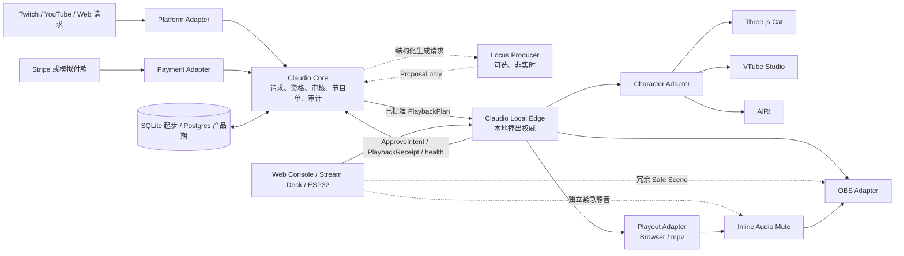
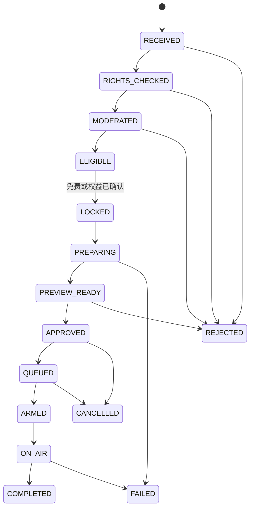

# Claudio Live OS 产品与开发计划书

> **历史候选方案，已暂停，非当前实施依据。** 自 2026-10-16 起，当前范围与工作顺序只见 [Claudio 统一实施方案](CLAUDIO_IMPLEMENTATION_PLAN.zh-CN.md)。下文直播、支付、硬件、Locus、Core/Edge 以及原工期均保留为 2026-08-11 的研究，不是私人聆听会话或 Folia 舞台的前置要求。可复用原则已由统一方案逐项采纳。

> 将 Claudio 从个人 AI 电台原型，演进为可审核、可恢复、可接入虚拟人与硬件的实时互动节目系统。

| 项目 | 内容 |
| --- | --- |
| 文档状态 | 原始 Draft v0.1，历史归档，非实施依据 |
| 编写日期 | 2026-08-11 |
| 当前基线 | Claudio `0.1.2` |
| 首个目标形态 | 单平台、单主播、单直播电脑上的 AI 直播副播 |
| 目标架构 | 模块化单体 + 本地 Edge + 可替换 Adapter |
| 预计功能开发 | 单名全职工程师约 9–12 个工程周；试播观察窗口、平台审核和权利谈判另计 |
| 可选 Locus 轨道 | M2 后增加约 1–2 个工程周；开发可并行，但试验使用独立 feature-flag cohort，不计入 M3 基线证据 |

## 1. 执行摘要

Claudio 当前已经证明了一条有价值的纵向链路：本地规则从真实可播放曲库中选歌并锁定 `songId`，大模型只负责理解与表达，DJ 输出受到固定 contract 和内容验证器约束。下一阶段不应重写这条链路，也不应把 AIRI、OBS、支付和直播平台揉进一个巨型应用。

建议把产品定位升级为：

> **Claudio Live OS 是一个 AI 实时舞台导演：把观众消息、订单和设备事件，安全、可控、可追踪地编排成声音、虚拟人、画面和硬件动作。**

第一阶段产品只解决一个清晰问题：帮助使用 OBS 的主播完成请求审核、AI DJ 口播、虚拟人联动、节目排队与故障接管。Claudio 拥有节目规则和审计记录；OBS、VTube Studio、AIRI、TTS、直播平台和支付供应商均作为可替换 Adapter 存在。

Locus 可以作为可选的幕后 AI 制片工作台：开播前生成结构化节目草案，直播中提前准备后续 DJ/Cue 提案，直播后分析脱敏回执。Locus 只拥有模型执行过程、日志和诊断，不能拥有 Claudio 的付款、权利、审核、队列、播放 lease 或硬件控制事实。

首个商业试点不得承诺播放任意商业歌曲。只有自有、委托原创或书面授权明确覆盖直播和互动点播的预审曲目，才能进入可付费队列。平台打赏只是互动事件，不自动等于购买权益或音乐许可。

## 2. 当前基线

### 2.1 已有资产

- 规则选歌、场景与偏好评分、近期播放冷却和多样性控制。
- 播放源预检和已锁定 `songId`，模型不能自行换歌。
- `{ say, play, reason, segue }` DJ contract、内容验证器和安全 fallback。
- KuGou-compatible 曲库、本地曲库、SQLite、OpenAI-compatible LLM 和 Fish TTS 接口。
- React + Vite 操作界面、REST、SSE、Three.js 黑猫 Companion。
- 现有 smoke、build 和若干播放、DJ、UI 行为测试。

### 2.2 当前缺口

- 播放准备和队列编排主要由 React 页面持有，浏览器关闭或刷新会影响权威状态。
- `now` 更接近 UI 上报的易失快照，还不是可以恢复和审计的真实播出状态。
- 没有请求、资格、付款、节目项、实际播放回执之间的正式状态机。
- 没有 OBS、虚拟人、直播平台和硬件的稳定能力协议。
- 没有为重复 Webhook、乱序事件、断网和进程重启设计的 inbox/outbox。
- 当前曲库与第三方能力不代表已经取得直播、商用或互动点播授权。

### 2.3 继承项目的治理边界

本项目代码采用 [Apache License 2.0](LICENSE)。继续开发和商业化前应：

- 保留原版权、许可证和已有作者历史，不改写来源。
- 为新增第三方代码、模型、声音、字体、角色和媒体维护 `THIRD_PARTY_NOTICES` 与来源清单。
- 将产品原创代码、外部 Adapter、第三方运行时和媒体资产分别记录，避免把根许可证错误地理解为覆盖全部发布物。
- 明确采用“维护独立 fork”还是“向上游贡献通用改进”的策略，并为长期分叉维护升级记录。

## 3. 产品定位

### 3.1 首要用户

1. 使用 OBS、虚拟形象或固定节目包装的独立主播。
2. 小型直播工作室、播客团队和虚拟主播团队。
3. 第二阶段的品牌活动、MCN 和线上发布会团队。

### 3.2 用户问题

- 主播同时管理聊天、点播、音量、字幕、虚拟人和节目节奏，认知负担过高。
- AI 可以生成内容，但难以保证不越权、不重复执行、不会在直播中失控。
- 现有自动化工具能触发动作，却通常不拥有可靠的节目状态、审批和执行回执。
- 云端模型、TTS、平台和网络发生故障时，直播仍需要继续。

### 3.3 产品价值

- **更高互动密度：** 把消息和请求转成结构化、可排队的节目内容。
- **更低场控负担：** 自动准备台词、语音、字幕、表情和 OBS Cue。
- **可控的 AI：** AI 提出计划，确定性规则和人工审批决定能否执行。
- **直播级可靠性：** 断网可继续，失败可降级，所有动作有回执和审计。
- **可扩展角色：** 当前黑猫、VTube Studio、AIRI、Warudo 和未来硬件共享同一角色能力协议。

## 4. MVP 定义

### 4.1 MVP 包含

- 单主播、单直播会话和一个直播平台 Adapter。
- 预审授权曲库、请求审核、优先级队列和稳定播放状态机。
- AI DJ 台词、TTS 音频缓存、字幕以及音乐 ducking。
- 当前 Three.js 角色或 VTube Studio 二选一的角色联动。
- OBS 场景、字幕、静音和 Safe Scene 控制。
- 主播操作台：预览、批准、拒绝、跳过、音乐静音、TTS 静音和人工接管。
- 幂等命令、断线恢复、审计记录和静态形象降级。
- 沙箱或模拟付款；只有完成权利确认后才进入真实付款试点。

### 4.2 MVP 不包含

- 任意版权歌曲、Spotify 或普通个人流媒体账号作为直播音源。
- Twitch Bits 换取指定预录歌曲的固定交易。
- 多平台并发、多租户、插件市场和模板交易市场。
- 自研 Live2D/VRM 渲染器或把 AIRI 源码直接合并进核心。
- Kafka、Kubernetes、Temporal 或按模块拆分的微服务集群。
- 定制主板、模具、内置功放、远场麦克风阵列和量产认证。
- 医疗、车载、机器人运动等安全关键控制。

### 4.3 关键用户旅程

#### 主播开播

1. 启动 Claudio Local Edge、OBS 和角色应用。
2. 系统完成曲库、音频、OBS、角色和平台健康检查。
3. 预加载至少 2–3 个已批准节目项或约 10 分钟安全内容。
4. 主播确认 Safe Scene、紧急静音和手动接管可用后开始直播。

#### 观众请求

1. 平台消息或外部页面创建请求。
2. 系统规范化身份和内容，检查目录权利、规则、频率与内容安全。
3. 需要付费时创建独立订单；只有验签后的支付事件才产生权益。
4. 系统生成并验证 DJ 文本、TTS、字幕和角色 Cue，供主播预览。
5. 主播批准后进入本地队列；Local Edge 获得播出 lease 后执行。
6. 实际播放器回报开始和结束，系统记录完成、失败或退款处理。

#### 故障接管

1. 角色失败时切换静态形象，不中断音乐和 TTS。
2. TTS 失败时使用已缓存短句或跳过口播，解除 ducking。
3. 云端失败时停止生成新内容，继续本地已批准队列。
4. OBS 控制断开时停止新的自动场景操作，允许主播手动接管。

## 5. 产品与工程原则

1. **确定性外壳包住生成式 AI。** AI 可以生成文本和 Cue 建议，不能直接改歌、确认付款或控制硬件。
2. **节目状态不属于浏览器。** 页面是命令入口和状态投影，后端才是队列与审批权威。
3. **事实分域。** 云端支付账本拥有支付事实；内容目录拥有资格事实；Local Edge 拥有真实播出事实。
4. **实时关键路径留在本地。** 云端可生成和管理，但不能成为暂停、静音、切场景和下一节目启动的强依赖。
5. **失败是正式产品路径。** 每个外部依赖都必须有 timeout、降级、人工接管和可观测状态。
6. **供应商可替换。** 核心只依赖能力 Port，不导入 OBS、AIRI、VTube Studio、Fish 或平台 SDK 类型。
7. **先模块化单体，后按证据拆分。** 只有出现第二个真实消费者和独立发布需求时才提取公开 SDK 或服务。
8. **权利先于付款。** 不确定能否播出的内容不能收费；付款成功也不能绕过内容资格和审核。

## 6. 目标架构



### 6.1 事实权属

| 事实 | 唯一权威 | 其他系统如何使用 |
| --- | --- | --- |
| 是否真实付款 | 服务端支付账本 | 通过不可变支付事件创建权益 |
| 内容是否允许播出 | 权利目录与审核策略 | 产生带版本的资格决定 |
| 请求处于什么业务阶段 | Claudio Core | UI 只订阅投影 |
| generation task、不可变 Draft、schema/item 版本、TTL、contentHash 与批准记录 | Claudio Core | 重启后仍能证明批准了哪一份内容 |
| Locus execution attempt、实际 provider、usage 和诊断 | Locus（启用时） | 成功返回时 Claudio 保存 job ID 与脱敏执行摘要 |
| 当前实际播放什么 | Local Edge + 播放器回执 | 云端接收 reported state |
| OBS 当前场景 | OBS | Adapter 上报，不反向代表业务完成 |
| 角色当前表情 | 角色运行时 | 属于表现层，可丢失、可重建 |

### 6.2 首版部署

首版在同一台直播电脑运行 Claudio 后端、Web 控制台和 Local Edge；OBS、角色运行时和播放器保持独立进程。Claudio 自有进程内部可使用 localhost HTTP/WebSocket 和 SQLite，不立即部署消息中间件；但 loopback 不等于授权，Edge/OBS/Device 控制端仍必须认证，并与 Locus 或其他通用 agent 运行身份隔离。

当出现真实支付、多设备或远程管理需求后，再加入云端 Postgres、对象存储和持久任务。直播电脑主动建立认证的出站 WSS，不开放家庭网络入站控制端口。

## 7. 通用事件与 Cue 模型

Claudio 最值得泛化的主链是：

```text
外部事件
→ 规范化
→ 权利/权限/内容策略
→ AI 生成计划
→ 确定性校验
→ 人工或自动批准
→ Cue 编排
→ Local Edge 执行
→ 真实回执、恢复与审计
```

### 7.1 Event Envelope

```text
eventId
eventType
schemaVersion
occurredAt
source
sessionId
aggregateId
sequence
idempotencyKey
payload
```

平台原始 payload 只能留在对应 Adapter 中。进入核心后必须转换成版本化内部事件。

### 7.2 Cue

```text
Cue
├── speak          说话
├── react          表情或动作
├── playMedia      播放音乐或视频
├── switchScene    切换 OBS 场景
├── overlay        字幕、商品或比分
├── device         灯光、按钮或未来硬件
└── fallback       失败后的替代动作
```

每个 Cue 至少包含触发来源、开始与截止时间、资源版本/hash、前置条件、并发关系、超时、降级动作和执行回执。

### 7.3 分离的状态机

请求与支付必须分成两个 Aggregate，避免把“已付款”错误理解为“可播出”。



```text
Payment:
CREATED → PENDING → PAID
                  ↘ FAILED / EXPIRED
PAID → REFUND_PENDING → PARTIALLY_REFUNDED / REFUNDED
PAID → DISPUTED → CHARGEBACK / RESOLVED
```

只有 `ELIGIBLE` 与有效权益同时成立，系统才能创建可入队的节目项。

首版允许记录 `PARTIALLY_REFUNDED`、`DISPUTED` 和 `CHARGEBACK`，但全部由人工处理，不承诺自动化争议处置。只有已经成功收款的 `PAID` 状态可以进入退款分支。

### 7.4 播出 lease 与 fencing

幂等 ID 只能防止同一命令重复处理，不能阻止旧 Edge 进程复活或两个 Edge 短暂并存导致双播。每个直播会话必须维护：

```text
agentEpoch      Edge 每次启动生成的新执行世代
leaseId         当前节目项的播出租约
fencingToken    单调递增的执行栅栏值
leaseExpiresAt  租约失效时间
```

- 同一会话同一时刻只能有一个获得有效 lease 的 Local Edge。
- 播放命令必须携带 `agentEpoch + leaseId + fencingToken`；播放器拒绝小于已见最大值的旧 token。
- Edge 必须定期续租；进程退出、心跳超时或主从切换都会使旧 lease 失效。
- 重启时处于 `ON_AIR` 但缺少可靠结束回执的项目进入 `RECOVERY_REQUIRED`，不得自动从头重播。
- 系统优先向播放器查询资源、位置和 session；无法对账时标记 `OUTCOME_UNKNOWN`，由操作员决定完成、跳过或退款。
- 任何“至多一次”保证都指规定幂等保留期内的业务副作用，不宣称分布式传输本身 exactly-once。

恢复矩阵：

| 持久状态 | 播放器事实 | 恢复动作 |
| --- | --- | --- |
| `APPROVED/QUEUED` | 未播放 | 使用新 lease 正常排队 |
| `ON_AIR` | 同一资源、有效 session 仍在播放 | 重新附着，只上报当前位置，不重新开始 |
| `ON_AIR` | 播放器已停止且存在结束回执 | 按回执完成或失败 |
| `ON_AIR` | 无法取得播放器事实 | 标记 `OUTCOME_UNKNOWN`，禁止自动重播并通知操作员 |
| 任意状态 | 播放器携带旧 fencing token | 停止或隔离旧播放实例，不接受其新回执 |
| `COMPLETED/FAILED/CANCELLED` | 收到迟到命令 | 忽略业务副作用，保留审计记录 |

## 8. 技术边界与复用方案

### 8.1 保留并强化

- `server/radio.ts`：规则选歌、场景/偏好、冷却与多样性。
- `server/dj-contract.ts`：锁定歌曲和严格 DJ contract。
- `server/dj-validator.ts`：虚构事实、表达与结构校验。
- `server/tts.ts`：Fish TTS Adapter 的起点，但浏览器 fallback 标记不能算作生产语音降级。
- `server/db.ts`：SQLite 起点，补充迁移、WAL、inbox/outbox 和状态表。

### 8.2 使用成熟外部方案

| 能力 | 采用 | 边界 |
| --- | --- | --- |
| 视频合成与推流 | OBS + 内置 obs-websocket | Claudio 不自研混流器；只通过协议控制 |
| 首版 2D 角色 | 当前黑猫或 VTube Studio | 角色不读取订单和队列数据库 |
| 开源角色实验 | AIRI 独立进程 | 锁版本；通过自有 Adapter；不依赖内部 Store |
| 正式本地播放 | 先保留 Browser，后增加 mpv JSON IPC | 不自研解码器和声卡层 |
| 支付 | Stripe Checkout + 验签 Webhook | 不信任 success URL；幂等异步处理 |
| 平台事件 | Twitch EventSub 或 YouTube Live Chat API | 不抓页面；平台字段只留在 Adapter |
| 可选 AI 制片 | Locus Local Job API v1 | 只接收结构化提案；不进入实时播出与硬件控制链 |
| 持久后台任务 | SQLite outbox 起步；产品期 Postgres + pg-boss | 实时播放 lease 不交给云任务队列 |
| 设备控制 | Web Console、Stream Deck、ESP32 Device Bridge | MCU 不保存平台、OBS 或支付凭据 |

官方接口参考：

- [OBS obs-websocket](https://github.com/obsproject/obs-websocket/blob/master/README.md)
- [VTube Studio Public API](https://github.com/DenchiSoft/VTubeStudio)
- [AIRI](https://github.com/moeru-ai/airi)
- [mpv JSON IPC](https://mpv.io/manual/master/#json-ipc)
- [Twitch EventSub](https://dev.twitch.tv/docs/eventsub/)
- [YouTube Live Chat Messages](https://developers.google.com/youtube/v3/live/docs/liveChatMessages)
- [Stripe Webhooks](https://docs.stripe.com/webhooks)
- [pg-boss](https://github.com/timgit/pg-boss)

### 8.3 Port 设计

```text
PlatformPort
PaymentPort
CatalogPort
MediaResolverPort
LlmPort
ProducerProposalPort
SpeechPort
PlayoutPort
BroadcastPort
CharacterPort
DevicePort
StateRepository
```

核心表达高层意图，例如“高兴地感谢用户”或“开始播出已锁定节目项”，Adapter 再将其翻译为 Live2D 参数、AIRI 事件、OBS source 名称或硬件命令。

### 8.4 逻辑包边界

初期先保持同一仓库内的模块边界；满足至少两个真实消费者、没有供应商字段泄漏并具有独立 contract tests 后，再发布独立包。

```text
@claudio/contracts
@claudio/runtime-core
@claudio/provider-sdk
@claudio/playout-runtime
@claudio/testkit

adapter-obs
adapter-vtube-studio
adapter-airi
adapter-mpv
adapter-fish
adapter-locus-producer
adapter-twitch 或 adapter-youtube
```

### 8.5 Locus Producer Mode（可选）

Locus 的定位是本地优先 AI 工作台和 runtime/job 层；Claudio 仍然拥有全部直播业务状态和最终用户流程。集成只使用 Locus 的机器可读 `locus api` Local Job API v1，不导入 Locus 源码，不读取其 SQLite，也不依赖 Electron/tRPC/UI 内部接口。Locus 不注册为直播快速路径的 `LlmPort` 实现，而是实现只能异步产出草案的专用 `ProducerProposalPort`。

推荐边界：

```text
Claudio ProducerProposalPort
  → LocusProducerAdapter
  → locus api runs create（kind: completion）
  → DjArtifactDraftV1 / RundownDraftV1
  → Claudio schema + 锁歌 + 权利 + 内容 + TTL 校验
  → 主播批准具体 contentHash
  → Claudio Core 创建正式节目项
```

实施规则：

- 开播前和直播预取只使用无工具、无 worktree、无 artifacts 的 `kind: completion`，并要求引用 Locus 中已保存的 provider profile。实时 Cue 解析和当前播放决策的类型签名不得接受 `ProducerProposalPort`。
- 同一台直播主机在直播会话期间禁止启动 Locus 完整 agent job。脱敏复盘、节目包检查或 Adapter 开发只能在会话结束后运行，或放到独立 OS 身份/另一台机器；输出保持 `proposal-only`。
- `consumer.runExternalId` 只作跨系统关联，不作为幂等键。Claudio 用自己的 generation task/outbox 防止重复上游调用和重复采纳。
- Claudio 拥有 JSON Schema。返回内容即使通过 Locus 校验，也必须再次通过现有 DJ contract、内容验证、锁定 Track、`itemVersion`、`expiresAt` 和允许 Cue 类型检查。
- 提案不得包含 Shell、文件路径、任意 URL、OBS source 名、设备 ID、串口指令、付款结论或新的未锁定 Track ID。
- Locus CLI 是同步本地调用，不是 HTTP/WebSocket 实时服务，当前 `create` 到终态才返回 job ID。首版把它视为不可恢复的辅助 subprocess：Claudio 在启动前持久化自己的 `generationAttemptId`，设置硬 deadline；成功终态才记录 Locus job ID，超时则标记 `TIMED_OUT_UNKNOWN`、丢弃输出且不自动重试。需要可恢复取消时，必须先在 Locus 建立正式的 async submit + unique external-id lookup + cancel 合同。
- `locus api runtimes list` 只用于确认 API 版本和 `completion`/`provider-binding` feature，不能证明某个 provider profile 可用。Profile 在 create 时 fail closed；设置界面可提供一次显式、可计费的 health completion 测试。
- Claudio 只传最小必要上下文。平台 token、支付 payload、provider key、不必要的观众身份和原始私密聊天不得进入 Locus job。
- Locus 的 `policyGrant.scopes` 当前不能作为 OBS、播放器或硬件的权限强制边界；这些能力继续由 Claudio/Edge 自己隔离。
- Loopback/localhost 不是授权边界。Edge、OBS Bridge 和 Device Bridge 必须使用独立服务身份，以及 Unix socket ACL、应用绑定 capability token 或 mTLS；Locus 身份不得读取 Edge token、OBS 密码、支付库或串口设备。无法在同机证明隔离时，Locus 移到独立 AI 主机，只通过认证的 Proposal Broker 传递窄化草案。
- 硬件 `approve` 只能发送 `ApproveIntent(proposalId, contentHash, itemVersion)` 给 Edge，再由 Core 校验并签发正式 `PlaybackPlan`；Core 断开时 approve 禁用。`skip/mute/Safe Scene/独立紧急静音` 继续作为本地安全控制，不经过 Locus。
- Locus 未安装、未启动、模型不可用或网络断开时，当前直播、已批准队列、静音、Safe Scene 和硬件控制必须完全不受影响。
- 进入实施时锁定并记录已审查的 Locus commit/版本、Local Job API schema hash 和平台证据；当前只有 macOS 本地 smoke 可作为已验证入口，Windows packaged 实机状态需另行验收。

进入 M2.5 前创建一份短 ADR/技术设计，冻结 `ProducerProposalPort`、`DjArtifactDraftV1`、`RundownDraftV1`、同步调用限制、deadline、数据最小化和降级契约。该文档是实施合同，不另建第二份产品路线图。

## 9. 版权、平台和角色许可闸门

### 9.1 音乐

- Spotify 不得作为商业直播和点歌的音频来源。其开发政策禁止非交互式广播、与视频同步、与其他音频混合以及商业流媒体集成，参见 [Spotify Developer Policy](https://developer.spotify.com/policy)。
- Twitch Bits 不应设计成“固定 Bits 换指定预录歌曲”，参见 [Twitch Bits Acceptable Use](https://www.twitch.tv/p/en/legal/bits-acceptable-use/)。
- YouTube Super Chat 是平台互动/资助事件，不自动授予歌曲录音、词曲、同步、公开表演或 VOD 权利。
- 可付费目录必须逐曲记录权利来源、地区、期限、允许平台、商业化、互动点播、VOD/Clips 和 Content ID allowlist 状态。
- 未确定权利的歌曲可以显示“不可点播”，不能进入结账流程。

### 9.2 角色

- AIRI 主代码的 MIT 许可不自动覆盖预置模型、Cubism Core、Spine runtime 或第三方资产。
- 首个公开产品优先使用当前原创/已确认资产，或合同明确允许软件内分发与商用的自有 VRM。
- 如果产品允许用户导入任意 Live2D 模型，应在公开发布前核对 Live2D Expandable Application 的审核和特别许可要求，参见 [Live2D SDK License](https://www.live2d.com/en/sdk/license/expandable/)。

### 9.3 发布前证据

真钱试播前必须具有：

- 曲目权利登记或限定为自有/明确授权目录。
- 平台应用审核、OAuth scope 与事件处理清单。
- 支付 Webhook 验签、退款和争议流程测试记录。
- 角色、声音和第三方运行时的许可证/合同清单。
- 隐私政策、数据保留周期和主播/观众删除请求流程。

## 10. 安全与可靠性

### 10.1 安全默认值

- 不确定是否批准：不播。
- 不确定是否付款：不产生权益。
- 不确定是否在说话：解除音乐 ducking。
- 角色链路断开：保留音频，切静态形象。
- 云控制面断开：继续本地已批准内容，不等待云端 ACK，也不接受新的远程配置。
- 操作台断开：当前已批准队列继续；需要人工批准的新请求停在 `PREVIEW_READY`。
- Edge 与播放器断开：不启动新节目项，解除 ducking，并在重连后先对账实际播放状态。
- Edge 与 OBS 断开：当前音频继续，不执行新场景动作，提示人工接管。

### 10.2 技术措施

- SQLite WAL、数据库迁移、定期一致性快照。
- Command inbox + transactional outbox；至少一次传输、业务幂等执行。
- 所有命令带 `commandId`、`itemId`、`itemVersion` 和过期时间；播放副作用还必须带 `agentEpoch`、`leaseId` 和 `fencingToken`。
- 外部服务分别配置 timeout、重试、熔断和健康状态；只自动重试幂等操作。
- OBS 密码和平台 token 仅由对应 Adapter 持有，使用系统 Keychain/凭据库。
- Edge、OBS Bridge 和 Device Bridge 使用独立服务身份与认证控制面；优先 Unix socket ACL/peer identity，跨机使用 mTLS。Locus 和通用 agent 账户不加入设备组，不获得控制 token、Keychain ACL 或串口权限。
- 云端连接只允许 Local Edge 主动建立的认证 WSS，不把本地控制端口暴露到公网。
- 统一关联字段：`requestId`、`paymentId`、`runId`、`itemId`、`trackId`、`agentId`、`commandId`。
- 保存事件和 Cue 回执，用 fake clock 做确定性重放和故障注入。

### 10.3 降级矩阵

| 故障 | 自动行为 |
| --- | --- |
| LLM 不可用 | 使用已验证模板，不改变锁定内容 |
| TTS 不可用 | 使用缓存/预录短句或跳过口播，恢复音乐音量 |
| 在线音乐源不可用 | 切授权本地缓存；没有安全内容则不播 |
| 角色崩溃 | OBS 切静态角色图，音频继续 |
| OBS WebSocket 断开 | 停止新自动场景动作，提示人工接管 |
| 平台事件断线 | 重连并对账；不凭猜测补造付款或请求 |
| 云端控制面断开 | Local Edge 执行已缓存节目单 |
| 操作台断开 | 已批准队列继续；新请求停在等待批准状态 |
| Edge 与播放器断开 | 不启动新项目；解除 ducking；重连后用 lease/fencing 对账 |
| Local Edge 重启 | 从快照和 outbox 恢复；终态不重播；不确定的 `ON_AIR` 进入人工恢复 |

## 11. 分阶段路线图

工期是单名熟悉 TypeScript/React/Node 的全职工程师工作量估算，不等于自然周发布日期。平台 OAuth/应用审核、种子主播排期、权利谈判和观察期不计入工程周。M3 功能可在第 8 个工程周具备，但必须另安排 2–4 个自然周完成免费受控试播；M4 在第 12 个工程周完成也只代表具备申请小额真钱试播的技术条件。每一阶段必须通过退出门槛，才能进入下一阶段。

### M0：基线与治理（第 1 周）

交付物：

- 当前 REST/SSE、数据库和外部依赖清单。
- 选歌、来源预检、`songId` 锁定、DJ 验证和 TTS fallback 的 characterization tests。
- 数据库备份/迁移规范、结构化日志和关联 ID。
- fork/上游策略、第三方通知模板和许可证登记表。
- 冻结首批试点画像：一个直播平台、一个操作系统、一个角色方案和 5–10 名同质种子用户。
- 输出 `ReferencePilotProfile`，记录平台、OS/硬件、OBS 版本、角色运行时、音频来源和不支持项。

退出门槛：

- `npm run smoke`、`npm run build` 通过。
- 无 LLM/TTS 时规则播放仍能工作。
- 当前 UI 和 API 行为没有非计划破坏。

### M1：后端成为节目权威（第 2–4 周）

交付物：

- `domain/application/ports/adapters` 逻辑分层。
- `Track` 与 `TrackSource` 分离，兼容原 `songId`。
- `ProgramRun`、`RundownItem`、`DjArtifact`、`AudioAsset`、Command inbox/outbox。
- 将 `hydrateAndPlayPick` 类编排从 React 迁入应用层。
- 定义最小 `PlayoutPort`，用当前 Browser 播放路径产生 `PlaybackStarted/PlaybackEnded` 回执。
- UI 只发送命令并订阅 projection。

退出门槛：

- 刷新或关闭浏览器不丢队列。
- 服务重启后可以恢复计划和投影状态；不确定的 `ON_AIR` 项进入 `RECOVERY_REQUIRED`，不会自动重播。
- 重复/乱序命令不会重复创建节目项或播放意图。
- 领域层不依赖 React、Express、SQLite、文件系统或网络 API。

### M2：本地直播纵向切片（第 5–6 周）

交付物：

- 在最小 Browser `PlayoutPort` 基础上增加 mpv Adapter 与 lease/fencing。
- OBS Adapter：字幕、场景、静音、Safe Scene。
- `CharacterPort` 与当前黑猫或 VTube Studio Adapter。
- 音乐/TTS 双通道、预取、ducking 和真实播放回执。
- 主播审批、拒绝、跳过和紧急接管操作台。

退出门槛：

- 连续 4 小时测试无双播、永久 duck 或状态漂移。
- 旧 `agentEpoch`/fencing token 被播放器拒绝；进程重启不会自动重播不确定的 `ON_AIR` 项。
- 本地 approve 到持久接受 ACK 的 p95 小于 250 ms，并单独记录实际效果回执延迟。
- 分别终止 TTS、角色和 OBS Adapter，行为符合降级矩阵。

### M2.5：Locus Producer Mode（可选，约 1–2 工程周）

该轨道在 M2 的 Cue schema、后端节目权威和后台 worker 稳定后开始。代码开发可以与 M3 日历观察期并行，但 M3 基线必须使用冻结 commit 且关闭 Locus feature flag；Locus 试验使用独立 cohort/窗口，其场次和时长不计入 M3 的 10 场、20 小时证据。它不是 M3 开播或 Claudio 独立运行的前置依赖。

交付物：

- `LocusProducerAdapter implements ProducerProposalPort`，只通过 Local Job API v1 CLI 调用；实时 `LlmPort` 注册表不能选中它。
- Discovery 预检只确认 API 版本和 `completion`/`provider-binding` feature；provider profile 在 create 时 fail closed，并提供显式 health completion 测试。
- Claudio 拥有的 `DjArtifactDraftV1` 与 `RundownDraftV1` JSON Schema。
- “Generate Rundown with Locus” 主播预览入口，以及逐项批准和结果 hash 审计。
- Claudio `generationTask`/`generationAttemptId`、deadline、熔断、模板 fallback；只在同步调用成功终态后关联 Locus job ID，超时记录 `TIMED_OUT_UNKNOWN` 且不自动重试。
- 可选的脱敏 `PostShowReview` 试验，只产生改进提案，不写正式节目数据。

退出门槛：

- 杀掉 Locus、模型或网络后，当前播出、已批准队列、OBS 和硬件控制没有中断或额外延迟。
- 未批准、重复、过期、旧 `itemVersion` 和 schema-invalid 的结果创建 Edge 命令数量为零。
- 恶意结果中的 Shell、URL、路径、OBS/设备字段和未锁定 Track 全部被拒绝，产生零外部副作用。
- `runExternalId` 重复不会导致重复采纳；Claudio 的幂等任务记录仍是唯一权威。
- 超时调用不会被描述为已取消或可恢复；未取得终态响应时没有自动 retry，后续结果也不能晋升为正式 Draft。
- Provider 凭据只由 Locus 持有；Locus job 中不存在支付信息、平台凭据和不必要的观众 PII。
- 负向访问测试证明 Locus 身份无法访问 Edge/OBS/Device 控制端、OBS 密码、支付库和 USB/串口。
- Core 断开时硬件 approve 被拒绝；skip、mute、Safe Scene 和独立紧急静音仍可本地执行。
- 至少用两种 provider/model profile 通过同一份 Claudio contract test，证明 Adapter 没有供应商字段泄漏。
- 在独立 Locus cohort 中测量开播准备时间和提案采用率；目标是准备时间下降 40%，至少 60% 的节目分段只需轻度修改即可采用，但未达到目标不阻断基础 Claudio M3。

### M3：单平台受控试播（第 7–8 工程周 + 2–4 自然周观察）

交付物：

- Twitch 或 YouTube 其中一个原生 Adapter。
- 统一事件 envelope、内容审核、频率限制和请求投影。
- 本地缓存、断线重连、事件去重和完整审计。
- 使用模拟权益或免费请求，不启用真实付费点歌。

退出门槛：

- 断网 30 分钟仍可执行已缓存节目。
- 重复投递同一事件 100 次只产生一个有效节目项。
- 在独立观察窗口内完成不少于 10 场、累计 20 小时的受控直播测试，不能把 Adapter 开发时间计作观察时间。

### M4：支付与权利闭环（第 9–12 工程周，外部审核另计）

进入条件：

- 已有权利清晰的预审目录。
- 已确认所选直播平台的付费互动设计没有违反平台条款。

交付物：

- Stripe Checkout、验签 Webhook、独立 Payment Aggregate。
- 权益创建、过期、失败、退款和争议处理。
- 权利目录版本、价格、审核和 operator 操作记录。
- 付款页明确说明购买的是互动/排队服务，不是未授权歌曲权利。

退出门槛：

- success URL 不能直接产生权益。
- 重复和乱序 Webhook 不会重复入队或重复退款。
- 不合格内容不会进入结账；已付但无法履行的订单能进入明确退款流程。
- 沙箱完整演练通过后，才允许小额、限量、人工值守的真钱试播。

### M5：AIRI 与硬件试点（软件试播稳定后）

进入条件：

- `CharacterPort` 至少经过当前 Three.js 角色和一个外部角色运行时两个实现验证。
- `DevicePort` 已由 Web Console 或 Stream Deck 验证一个非定制硬件实现；ESP32 试点将成为第二个实现。
- 软件连续运行 72 小时，无 P0/P1 故障。
- 完成角色、运行时、声音和媒体资产许可审查。

其中：

- `P0`：未授权/未付款内容被播出、重复扣费或重复付费播放、无法紧急静音、持久数据损坏或秘密泄露。
- `P1`：直播中断超过 30 秒、永久 duck、需要重启整机才能恢复，或状态漂移需要人工修改数据库。
- 72 小时 soak 必须记录软件/OBS/OS/声卡版本和固定负载，至少包含 8 小时活跃播出、1,000 个控制命令，并注入 LLM/TTS/角色/OBS/播放器退出、网络中断、USB 重连、CPU 压力、磁盘空间不足和声卡重连。

交付物：

- AIRI VRM-only 独立 Adapter，锁定版本并具有静态形象 fallback。
- 首个硬件原型 Claudio Edge Deck：ESP32-S3 按键/旋钮 + 5–7 英寸状态屏。
- `ApproveIntent(proposalId, contentHash, itemVersion)`、skip、音乐/TTS 静音、Safe Scene 与音量命令；只有 approve 必须回到 Core 校验并换取正式 `PlaybackPlan`。
- USB 串口 Device Bridge；MCU 不保存平台、支付或 OBS 凭据。
- 独立 watchdog 服务，以及不依赖 Local Edge 业务进程的紧急静音路径；Safe Scene 保留直达 OBS 的冗余控制。

退出门槛：

- 上电 60 秒内可操作；GPIO 输入到 durable ACK 的 p95 小于 150 ms，独立紧急静音实际生效的 p99 小于 100 ms。
- 1,000 次按键测试做到零丢失、零重复、顺序正确，并覆盖按键抖动、组合键和 USB 重连。
- 20 次掉电恢复无数据库损坏或已完成内容重播；注入点覆盖命令已落库未 ACK、开始播放未落 `PlaybackStarted`、播放结束未落 `PlaybackEnded` 和 outbox 未确认。
- Edge/Bridge 卡死和主机过载时，独立紧急静音仍然有效。
- Core 断开或 content hash 不匹配时 approve 明确拒绝并显示故障状态；skip/mute/Safe Scene 保持可用。
- 5–10 台试点后，才评估 CM5、定制主板、功放与外壳。

普通硬件动作必须在测试前绑定明确的 effect receipt，退出阈值如下：

| 动作 | 实际效果回执 | p95 | p99 |
| --- | --- | ---: | ---: |
| approve / skip | Edge 状态迁移并更新设备显示 | < 250 ms | < 500 ms |
| 音乐 / TTS mute | OBS/音频 Adapter 确认输入实际静音 | < 300 ms | < 750 ms |
| Safe Scene | OBS 回报目标场景成为 Program Scene | < 500 ms | < 1 s |
| volume | 音频 Adapter 回报目标增益已应用 | < 250 ms | < 500 ms |
| 独立紧急静音 | 硬件路径确认输出被切断 | — | < 100 ms |

任何动作超过 2 秒仍没有 effect receipt 都记为失败；1,000 次验收样本中不得出现丢失或错误动作。

### M6：平台化（有第二个真实场景后）

- Creator 桌面版：单主播订阅。
- Studio：团队权限、节目模板、运行报告和多设备管理。
- Character/Edge SDK：面向品牌、游戏和活动集成商。
- Edge Fleet：设备身份、配置、分批更新、健康监测和远程恢复。
- 只有真实需求出现后，才评估公开插件市场和拆分服务。

## 12. 成功指标

### 12.1 测量约定

- 所有结果绑定 Git commit、`ReferencePilotProfile`、OS/OBS/角色/播放器版本和测试时间窗。
- `durable ACK` 指 Edge 已将命令及接受/拒绝结果持久化，不代表外部动作已经发生。
- `effect receipt` 指播放器、OBS、角色或硬件 Adapter 回报可观察的实际效果；两种延迟分别统计。
- 延迟指标至少采集 1,000 个本地控制样本；直播内容指标按完整会话和全部合格请求统计，不只抽取成功样本。
- 普通节目命令的幂等记录至少保留到会话结束后 24 小时，平台事件至少 7 天，支付事件 ID 与权益映射至少 180 天。
- 可靠性表述为“同一幂等键在保留期内产生至多一次有效业务副作用”；传输仍采用至少一次投递。

### 12.2 技术指标

- 4 小时连续直播无双播、永久 duck 或不可恢复状态漂移。
- 所有 `ELIGIBLE` 且权益有效、进入 `LOCKED` 的请求中，至少 95% 到达 `PREVIEW_READY`；其余必须产生可解释失败且不得收费。
- 所有 `APPROVED` 节目项中，至少 98% 到达 `COMPLETED`；主播主动取消单独统计，不从分母静默删除。
- 每个有效付费权益必须达到 `COMPLETED`，或在公开 SLA 内进入 `REFUND_PENDING`；受控试播 SLA 暂定 24 小时。
- 本地控制命令 durable ACK p95 小于 250 ms；实际 effect receipt 延迟按 Adapter 单独设基线和告警。
- 非生成式互动可见响应 p95 小于 2 秒；生成式语音开始目标 p95 小于 5 秒，并单独记录供应商等待时间。
- 同一幂等键在规定保留期内的有效业务副作用至多一次。
- 断网 30 分钟继续已缓存节目；恢复连接后不倒退状态或重复播放。
- 任一未验签支付事件产生的有效权益数量为零。
- 角色或 OBS Adapter 故障时 3 秒内进入明确降级状态。

### 12.3 产品验证指标

- 招募 5–10 位符合 `ReferencePilotProfile` 的同质种子主播，其中至少 70% 完成设置和首次直播。
- 完成不少于 10 场、累计 20 小时的真实场景测试。
- 四周内至少 50% 的已激活主播主动进行第二次使用。
- 与现有方式相比，每小时人工场控操作数量下降至少 30%。
- 付费意愿单独验证：至少 3 位用户愿意在给定价格下付费或支付可退订金。
- 继续测试意愿单独验证：至少 60% 的已激活用户愿意参加下一阶段试点。
- 记录主播否决 AI 建议、人工接管和故障降级的原因，而不只统计生成次数。

### 12.4 进入硬件的商业闸门

以下条件未满足时，不开始定制 PCB 或模具：

- 至少 5 名目标用户完成 30 天付费硬件试点或支付可退订金。
- 试点设备周活跃率不低于 80%，并且多数试点用户在给定目标价格下明确选择专用设备而非 Stream Deck 组合。
- Edge API 和 Device contract 已稳定。
- 整个试点的 P0 必须为 0；出现任何未关闭 P0 都自动阻断硬件化。
- 修复关闭后的 P1 频率必须低于每 100 运行小时 1 次，且不存在未关闭 P1；平均支持投入低于每台每周 30 分钟。
- 目标 BOM 不高于目标售价的 35%，计入组装、渠道、退换和保修准备金后的预计硬件毛利不低于 45%。

## 13. 风险登记

| 风险 | 影响 | 应对 |
| --- | --- | --- |
| 音乐权利不覆盖互动点播 | 无法上线或直播被中断 | 自有/委托/逐曲授权目录；权利先于结账 |
| 平台打赏规则变化 | 付费模型失效 | Platform Adapter 隔离；Stripe/免费请求作为不同权益策略 |
| KuGou-compatible 服务不稳定或条款不适用 | 播放失败或合规风险 | 本地授权目录优先；Provider 能力与来源健康检查 |
| LLM/TTS 延迟或故障 | 冷场、永久 duck | 提前生成、缓存、模板、超时和静默 fallback |
| Locus CLI/模型不可用或迟到结果 | 准备任务失败、错误提案进入旧节目版本 | 可选 Adapter、deadline/熔断、版本/TTL 校验；实时链路不依赖 Locus |
| Locus job 泄露观众或支付数据 | 隐私、平台和安全风险 | 数据最小化、字段 allowlist、脱敏复盘；不传 token、付款 payload 或非必要 PII |
| UI 与真实播放状态漂移 | 重复播出或错误记账 | 后端权威队列、播放器回执、命令 lease 和恢复测试 |
| AIRI/Live2D 版本与许可变化 | 集成失效或无法分发 | 分进程、锁版本、VRM-only 首发、第三方通知和发布前复核 |
| OBS/角色本地端口暴露 | 直播电脑被控制 | localhost、密码、最小权限和出站云连接 |
| 范围过大 | 长期无法试播 | 单平台、单角色、单会话；阶段闸门阻止提前平台化 |
| 过早硬件化 | 成本和售后拖垮项目 | 先用 Stream Deck/ESP32 原型；以 5–10 台试点验证 |

## 14. 商业与泛化路线

### 14.1 产品层级

1. **Claudio Creator**：个人主播桌面 AI 副播，按频道和用量订阅。
2. **Claudio Producer Mode**：可选连接 Locus，提供节目准备、模型运行证据和脱敏复盘。
3. **Claudio Studio**：团队权限、节目模板、审核席和运行报告。
4. **Claudio Character SDK**：品牌、游戏和活动公司接入自有角色和业务系统。
5. **Claudio Edge Box**：面向演播室、展会和门店的预装本地运行设备。
6. **Claudio Fleet**：设备配置、健康状态、版本更新和远程恢复。

### 14.2 可横向应用的场景

- AI 直播副播、互动播客、问答和游戏节目。
- 品牌直播、发布会和线上活动主持。
- 电竞/体育数据驱动解说和画面包装。
- 展会、博物馆和零售空间虚拟角色。
- 企业培训、销售演练和语言陪练终端。
- 门店 AI Radio、数字标牌和未来桌面陪伴设备。

最值得积累的长期资产不是某个 LLM、头像或 TTS，而是事件到 Cue 的可靠转换、实时执行和故障恢复、人工与 AI 协同、经过真实节目验证的模板，以及可替换的角色/平台/设备 Adapter 生态。

## 15. 建议团队与工作方式

受控试播阶段的最小团队：

- 1 名全职 TypeScript/React/Node 工程师，负责核心、Edge、Adapter 和操作台。
- 1 名兼职产品/节目设计，负责 DJ 人设、节目模板和主播测试。
- 1 名兼职视觉/角色设计，负责角色资产和直播包装。
- 在启用真实支付或分发第三方角色前，安排音乐/平台/角色许可专业复核。

工程工作方式：

- 每个阶段在独立分支交付，小批次合并，保留兼容 façade。
- 先为当前行为建立 characterization tests，再移动代码。
- 每个 Adapter 必须提供 capability、health、timeout、错误映射和 contract tests。
- 所有完成声明区分本地验证、受控试播、真实平台上线和用户接受。
- 不以单元测试代替真实 OBS、真实播放器和连续直播验证。

## 16. 原候选方向的前十项工作（历史，已暂停）

本节不再构成当前待办。私人会话与 Folia 实验的实施顺序只见 [统一实施方案](CLAUDIO_IMPLEMENTATION_PLAN.zh-CN.md)。

1. 建立 ADR：事实权属、Local Edge、支付与请求分离、角色 Adapter、权利目录。
2. 固化 `/api/radio/next`、`/api/dj/line`、播放源预检和 TTS 当前行为测试。
3. 定义 Event、Command、Cue、PlaybackReceipt v1 schema。
4. 新增 `ProgramRun`、`RundownItem`、`DjArtifact`、`AudioAsset` 状态模型。
5. 为 SQLite 增加迁移、WAL、inbox 和 transactional outbox。
6. 把页面中的准备/播放编排迁入后端 application service。
7. 实现 Browser `PlayoutPort`，保持当前 UI 行为兼容。
8. 实现 OBS Adapter 和 Safe Scene；验证密码与 localhost 边界。
9. 实现当前 Three.js 角色的 `CharacterPort`，再用 VTube Studio 验证可替换性。
10. 选择 Twitch 或 YouTube 的一个沙箱 Adapter，先跑免费/模拟权益受控试播。

Locus 不属于上述首轮十项的前置工作；它在 M2 完成后按 M2.5 进入，避免在节目权威和实时播出尚未稳定时扩大范围。

## 17. 原候选方向的关键决策摘要（历史）

以下第一步与优先级仅属于已暂停的 Live OS 路线；当前工作包由 [统一实施方案](CLAUDIO_IMPLEMENTATION_PLAN.zh-CN.md) 决定。

- **不重写 Claudio；** 保留选歌、锁歌、DJ contract 和验证器。
- **不先拆微服务；** 首版是模块化单体和本地 Edge。
- **不把 AIRI 变成核心；** AIRI 是可替换角色 Adapter。
- **不把 Locus 变成实时大脑；** Locus 是可选 proposal/runtime Adapter，Claudio 保留全部业务与播出权威。
- **不自研 OBS、播放器、支付页或虚拟人渲染器。**
- **不使用 Spotify 作为直播音源。**
- **不在权利确认前接真实付费点歌。**
- **不在软件稳定和用户付费意愿验证前定制硬件。**
- **第一项开发工作是让后端成为节目权威，而不是增加更多外部集成。**
