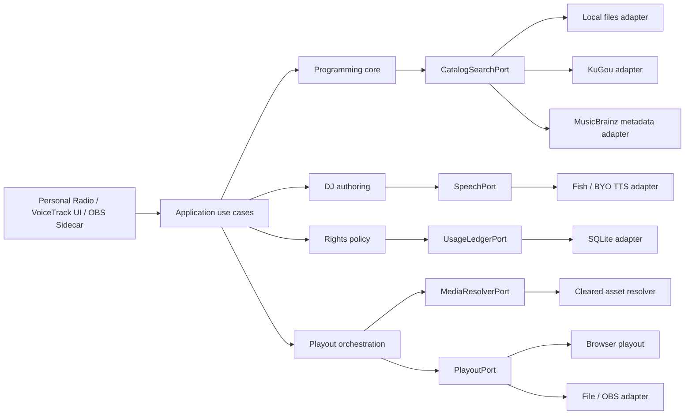

# Claudio 模块化、国际适配与产品方向评估

> **历史架构与平台研究，非当前实施依据。** 自 2026-10-16 起，范围、合同、实施顺序与进度只在 [Claudio 统一实施方案](CLAUDIO_IMPLEMENTATION_PLAN.zh-CN.md) 维护。以下“当前”、Phase、测试结果和平台判断均按原日期理解；本文保留论证与代码切片记录，不单独分配活动任务。
>
> 原始状态：架构评估已完成；首个最小重构切片已实施，原验证结果见本文第 12 节。
>
> 证据截止：2026-08-15（Pacific/Auckland）
>
> 文档性质：产品与架构决策输入，不是法律意见、商业承诺或完整 Live OS 实现说明。
>
> **原产品方向更新（2026-08-15）**：在明确“开源、自用、单用户、非推流”后，本文的 VoiceTrack Sidecar、OBS 与商业广播路线降级为历史研究。当时的个人版论证见 [私人聆听会话历史决策](CLAUDIO_PERSONAL_LISTENING_SESSION_PLAN.zh-CN.md)；最新执行依据只见上方统一方案。本文仍保留模块化、平台边界、权利风险和竞品研究作为参考。

## 1. 先给结论

Claudio **值得拆，但不值得现在拆成微服务或多个 npm 包**。正确目标是“高内聚、低耦合”：把选歌、DJ 串词、目录、播放、TTS、权利判断分别组织成能独立测试的能力；具体平台、数据库和浏览器实现通过窄接口接入。

当时的判断是保留个人 AI 电台，并验证统一的个人 `ListeningSession`：用户锁定歌曲与顺序，AI 只填补未锁定位置和生成可选表达，而非立即替换海外消费者平台或建设完整电台操作系统。当前采纳范围见 [统一实施方案](CLAUDIO_IMPLEMENTATION_PLAN.zh-CN.md)。

在此前尚未明确个人自用边界时，本文还评估过下面的商业候选；该候选现已暂停，仅作为历史研究保留：

> **Claudio Cue & VoiceTrack Sidecar**：读取已经确定的节目单，为小型网络电台、中文/双语主持和 OBS/VTuber 团队生成可审阅、可编辑、可批准的串词、语音文件、字幕和 Cue，再交回现有播放或直播系统执行。

它不替换客户的音乐播放器或 automation，不提供音乐许可，也不允许模型直接控制播出设备。

本轮已经做的代码改造仅是第一步：建立供应商无关的目录搜索端口，把 KuGou 原始 DTO 映射集中到 Adapter，并将数据库曲目记录与公开 API DTO 分离。它证明拆分路径可行，**不代表国际化、海外音源、音乐授权或 Sidecar 已经完成**。

## 2. 证据标签

- **[已证实]**：由当前仓库代码、测试，或厂商/权利机构官方资料直接支持。
- **[推断]**：基于证据作出的架构或产品判断，尚未经过真实用户或生产运行验证。
- **[未来项]**：可设计或计划中的能力，当前仓库没有实现。

“竞品已具备”“计划书中存在”“技术上可以做”均不等于 Claudio 已具备。

## 3. 术语：到底是高内聚、低耦合

正确说法是：**高内聚，低耦合**。

- 高内聚：同一业务能力的规则、数据和测试放在一起。例如“锁定节目项、生成串词、校验串词、失败回退”共同属于 DJ Authoring。
- 低耦合：推荐模块只接收曲目、偏好和历史，不直接知道 SQLite 表、KuGou 响应格式或 React 状态。
- 低耦合不等于零依赖。HTTP 启动层本来就需要知道各模块并完成组装；关键是业务核心不反向依赖所有外部实现。
- 可复用不等于立即发布包。一个具有清晰输入输出、可独立测试的仓库内模块，已经具备有效复用价值。

## 4. 当前仓库：已有能力与耦合位置

### 4.1 已有能力

**[已证实]** 当前 Claudio 是 React/Vite + Express + SQLite 的本地个人 AI 电台原型，已有：

- 规则选歌、偏好信号、近期播放冷却和多样性控制；
- 锁定歌曲 ID 后再让模型表达的 DJ contract；
- DJ 文案生成、结构/内容校验和 fallback；
- KuGou-compatible 搜索、曲库同步和播放源解析；
- Fish Audio TTS 与浏览器 fallback 标记；
- 浏览器队列、双音轨播放和 Now Playing 投影；
- SQLite 中的曲目、播放、偏好、聊天、记忆、推荐审计和日计划。

### 4.2 主要汇聚点

**[已证实]** 当前文件级分离已经存在，但以下文件承担了过多职责：

| 文件 | 当前职责 | 主要问题 |
| --- | --- | --- |
| `server/radio.ts` | 场景、偏好、历史、推荐、天气、模型、播放源 | 纯评分规则与 I/O 混合，难以在其他壳中复用 |
| `server/chat.ts` | 意图、点歌、队列、天气切换、歌单、闲聊、记录 | 一个入口协调过多用例，默认供应商曾隐含在核心函数里 |
| `server/db.ts` | 几乎全部持久化读写 | 业务模块直接依赖全局 SQLite 实现 |
| `server/index.ts` | HTTP 路由、依赖组装、部分响应映射 | 作为 composition root 可以高依赖，但不应承载业务规则 |
| `src/App.tsx` | UI、播放、队列、聊天、TTS、天气、KuGou 登录 | 浏览器播放状态机和界面状态难以单独验证 |
| `server/types.ts` / `src/types.ts` | 服务端记录与客户端 DTO | 原先混淆了持久化字段和公开字段 |

### 4.3 最值得复用的资产

**[推断]** 值得保留并逐步抽出的不是整套 App，而是以下机制：

1. 先锁定节目项，再允许模型表达；
2. 模型输出中的歌曲 ID allowlist；
3. 场景、偏好、冷却、多样性与可解释评分；
4. DJ 生成、校验、fallback 与反馈样本；
5. Catalog 与 Media Resolver 分离；
6. 双音轨、取消陈旧串词、ducking 与播放 receipt 状态机；
7. Now Playing 只读投影；
8. 音频 artifact + sidecar JSON 的交付方式。

### 4.4 不应直接抽成通用包

**[推断]** 以下内容应留在具体 Adapter 或 Claudio 产品层：

- KuGou 登录、session、subprocess 与响应解析；
- 当前全局模型配置、供应商 fallback 和错误语义；
- Claudio 人设、中文 few-shot 与表达 validator；
- 天气、日历和个人口味规则；
- 当前 SQLite schema；
- 整个 `App.tsx`；
- 依赖 Claudio 品牌、全局 CSS 或特定 DOM 的 UI。

## 5. 目标架构：模块化单体，而不是微服务



依赖原则：

- 业务规则定义 Port，外部 Adapter 实现 Port；
- 供应商原始 DTO 不进入业务核心；
- SQLite record 不直接作为公开 HTTP DTO；
- composition root 负责选择“当前默认仍是 KuGou”之类的部署决定；
- 模型只产出 proposal 或 draft，不能直接产出不可逆播放命令。

### 5.1 建议的内部模块

| 当前代码 | 目标模块 | 说明 |
| --- | --- | --- |
| `server/radio.ts` | `modules/programming` | 纯 `rankTracks` policy + application service |
| `server/direct.ts`、`playlist.ts` | `modules/programming/import` | 点歌、歌单解析、身份匹配 |
| `server/dj*.ts` | `modules/dj-authoring` | 锁定 item、prompt、生成、校验、fallback |
| `server/library.ts` | `modules/catalog` + `adapters/local-files` | 文件扫描是 Adapter，不是 Catalog 业务 |
| `server/kugou*.ts` | `adapters/kugou` | 供应商专用实现，不作为通用 API |
| `server/playback-source.ts` | `modules/media-resolution` | 通过 `MediaResolverPort` 选择可播放资产 |
| `server/tts.ts` | `adapters/fish` | 实现 `SpeechPort` |
| `server/now.ts` | `modules/playout/read-model` | 只读状态，不冒充播放事实 |
| `src/hooks/useAudio.ts` | `adapters/browser-playout` | 浏览器音频实现 |
| `server/db.ts` | `adapters/sqlite` | 业务模块只依赖窄 repository port |
| `server/chat.ts` | `app/chat` | 用例协调层 |
| `server/index.ts` | `app/http` | 路由与依赖组装 |

### 5.2 最小 Port 形状

```ts
interface CatalogSearchPort {
  search(query: string, limit?: number): Promise<readonly TrackRecord[]>;
}

interface MediaResolverPort {
  resolve(track: TrackIdentity, policy: PlaybackPolicy): Promise<PlayableMedia>;
}

interface SpeechPort {
  synthesize(input: SpeechRequest): Promise<SpeechArtifact>;
}

interface PlayoutPort {
  prepare(plan: PlaybackPlan): Promise<void>;
  execute(command: PlaybackCommand): Promise<PlaybackReceipt>;
}
```

推荐评分本身不需要 Port，优先变成纯函数：

```ts
rankTracks({ tracks, history, taste, profile, scene, random }): RankedTrack[]
```

## 6. 首个最小重构切片

### 6.1 已实施

**[已证实]** 本轮在不改数据库 schema、不新增海外 provider、不改变 UI 播放流程的前提下完成：

1. 新增 `CatalogSearchPort`，`direct.ts` 不再 import KuGou 类型、搜索函数或库同步模块；
2. 新增 KuGou Catalog Adapter，集中处理 `KuGouSong -> TrackRecord`、稳定 ID 和 locator 映射；
3. `chat.ts` 成为当前默认 Adapter 的显式组装点；
4. 服务端类型明确区分 `TrackRecord` 与公开 `TrackDto`；
5. `/api/library` 使用显式字段白名单，不返回 `filePath`、`folder`、`size`、`addedAt`；
6. 普通曲目查询默认不再按 `file_path` 命中；只有显式内部 opt-in 才允许，避免曲库和推荐入口通过查询确认内部路径；
7. Now Playing 白名单修复了 `kugou-api` 被错误降级为 `main` 的来源漂移；
8. 新增核心、Adapter、DTO、查询旁路和 Now Playing 的正向/负向测试。

### 6.2 仍是过渡状态

**[已证实]** 这个 Port 当前仍返回 legacy `TrackRecord`，而 `source` union 仍含 `kugou-api`。因此：

- 已经隔离了供应商原始 DTO；
- 还没有完成 provider identity、playback locator、rights evidence 与持久化记录的彻底分离；
- `playback-source.ts` 当前仍只实现 KuGou-compatible 远程解析；
- 默认用户文案仍会明确说“酷狗”，因为当前部署的默认 provider 仍是 KuGou；
- 不能据此宣称 Spotify、Apple Music、MusicBrainz 或其他海外服务已接入。

### 6.3 已知相邻风险，未塞入本切片

- `/api/health` 仍返回 `libraryDir`；服务默认只监听本机，但未来公网/Sidecar 部署前应改成布尔能力字段；
- 扫描失败响应可能包含底层文件系统错误；公网部署前应改为稳定错误码；
- 本地 track ID 来自绝对路径哈希，迁移 ID 会影响历史和外键，需要独立 migration；
- HTTP app 尚未抽成 `createApp`，当前 API 边界测试以纯 mapper、真实 SQLite 查询测试和路由结构闸门共同覆盖；后续应补真实 HTTP integration test。

## 7. 国际平台不是“换个 API”

国际适配必须把三件事分开：

1. **元数据目录**：知道“这首录音是谁”；
2. **个人账户播放**：用户在具体平台授权并主动播放；
3. **节目/广播资产**：音频可进入 Claudio 的 mixer、TTS 叠加、录制或多人传输。

平台返回 `playable=true` 只说明技术上可播放，不能证明有节目、混音、公共表演或广播权。

### 7.1 平台能力矩阵

| 来源 | 元数据/链接 | 个人原生播放 | 进入 Claudio 节目总线 | 建议 |
| --- | --- | --- | --- | --- |
| MusicBrainz | 是 | 否，不存录音 | 否 | 默认开放元数据与实体解析层 |
| Spotify | 有条件 | Premium + 官方播放能力 | 否 | 只做 deep link/用户账户体验，不进 mixer |
| Apple Music / MusicKit | 有条件 | 用户授权/订阅 | 默认否 | 只做原生个人播放；更深用途另取许可 |
| YouTube | 搜索、可见官方嵌入 | 可见官方播放器 | 否 | 不抽音轨、不做后台 headless radio |
| SoundCloud | 元数据、链接、狭义用户播放 | 有条件 | 否 | 官方条款直接限制 webcasting/聚合 |
| Audius | 是 | 是 | 有条件 | 只接明确 OML/兼容许可并保存许可快照 |
| Jamendo | 是 | 视产品而定 | 有条件 | API 访问不等于广播许可，逐曲/项目持证 |
| 本地/直授权资产 | 自有 | 是 | 有条件 | 默认节目资产，必须保存权利凭证与地域 |

官方政策给出的关键边界：

- [MusicBrainz](https://musicbrainz.org/doc/About) 明确不存储也不访问录音；核心数据与补充数据采用不同许可，不能把 metadata 命中当作播放授权。
- [Spotify Developer Policy](https://developer.spotify.com/policy) 禁止 non-interactive webcasting、跨服务流聚合、segue/mix/remix/overlap，以及面向电台或商业场所的播放。
- [Apple App Review Guidelines](https://developer.apple.com/app-store/review/guidelines/) 对 Apple Music 访问、用户发起的播放控制、变现和更深媒体用途有明确限制；MusicKit 不是通用广播许可。
- [YouTube API Policies](https://developers.google.com/youtube/terms/developer-policies) 不允许分离/修改音频、隐藏播放器或绕过官方播放体验。
- [SoundCloud API Terms](https://developers.soundcloud.com/docs/api/terms-of-use) 不把用户上传内容的权利授予 API 使用者，并限制 webcasting radio 与跨服务聚合。
- [Audius Open Music License](https://audius.org/open-music-license.pdf) 为符合该许可的 Music Player 用途提供较宽授权，但曲目可能采用替代许可，上传者声明也不消除实际权利风险。
- [Jamendo Individual Licenses](https://support-licensing.jamendo.com/individual-licenses) 按项目、地域和用途区分许可，API access 本身不是广播许可。

### 7.2 建议的权利边界

```ts
type RightsDecision = "allow" | "deny" | "unknown";

type ClearedAsset = {
  audioRef: string;
  recordingRights: RightsEvidence;
  compositionRights: RightsEvidence;
  territory: string[];
  audienceMode: "personal" | "private-preview" | "public-linear";
  commercial: boolean;
  broadcast: boolean;
  mixOrDerivative: boolean;
  expiresAt?: string;
  attribution: string[];
  receiptHash: string;
  termsVersion: string;
};
```

默认规则：`unknown` 必须 fail closed。Spotify、Apple、YouTube、SoundCloud 的用户播放音频不得进入 Claudio mixer、代理、录制、ducking/TTS 叠加或多人广播路径。

### 7.3 区域差异：美国、英国、新西兰

以下是架构输入，不是法律意见：

- **美国**：[SoundExchange Licensing 101](https://www.soundexchange.com/service-provider/licensing-101/) 说明 112/114 法定许可主要覆盖符合条件的非交互式数字音频传输及临时复制；互动/on-demand 需要直接许可。录音与词曲是两层权利，通常还要处理 composition public-performance 权利。其[报告要求](https://www.soundexchange.com/service-provider/reporting-requirements/)包含曲目身份、ISRC/专辑与 label、听众或 ATH 等使用数据。
- **英国**：[PPL Linear Webcast Licence](https://www.ppluk.com/licensing/playing-music-online/linear-webcast-licence/) 面向特定 UK 线性在线广播录音权路径；PRS for Music 负责不同的词曲权利范围。不能把两者当作互相替代。
- **新西兰**：[Recorded Music NZ 的 Digital and Online 指引](https://recordedmusic.co.nz/licences/digital-and-online) 与 [APRA AMCOS NZ](https://www.apraamcos.co.nz/music-licences/select-a-licence/tv-radio-licences/community-radio) 分别体现录音与词曲/communication 等权利层。产品默认应以 NZ 私人预览或 BYO-cleared media 开始，公共传播另设 Territory Gate。

因此未来需要 `RightsPolicyPort`、`TerritoryGate` 和 `UsageLedgerPort`，但首版不需要建设“全球授权系统”；先把个人/预览与公共广播路径物理隔离即可。

## 8. 国际产品适配，不只是英文翻译

**[未来项]** 最小国际化 contract 应包含：

- BCP 47 locale，如 `zh-CN`、`en-NZ`；
- IANA timezone，如 `Pacific/Auckland`；
- 日期、时间、温度、距离与计量制式；
- locale-specific 人设、表达 validator、few-shot 与发音词典；
- 新闻、天气、活动信息的来源、抓取时间和适用地区；
- Unicode/CJK/拉丁字符兼容的歌曲身份和搜索；
- 人名、艺人、毛利语地名等 pronunciation override；
- BYO TTS/LLM provider，不在 contract 中泄漏厂商字段；
- voice cloning 的授权主体、用途、期限、撤销状态；
- 音乐权利的地域、用途、商业性和到期时间。

推荐首个海外环境不是“全球”，而是 **新西兰本地 + 英文/中文双语 + 本地已清权音频**。这样能先验证 locale、时区、发音和权利边界，而不同时承担全球 catalog 与广播许可。

## 9. 国际竞品与可借鉴成品

### 9.1 能力矩阵

| 产品 | 定位 | 可借鉴 | 不应复制 | 公开价格/边界 |
| --- | --- | --- | --- | --- |
| [Futuri AudioAI](https://futurimedia.com/products/audio-ai) | 传统广播的 AI DJ 与本地内容层 | 接现有 WideOrbit/RCS/ENCO automation、填无人时段 | 企业级实时资讯、独家声音、24/7 支持与收入承诺 | 无公开价格，销售/demo；音乐许可未声明包含 |
| [Super Hi-Fi Program Director](https://www.superhifi.com/products/program-director) | 完整 Radio Operating System | 节目项模型、catalog、确定性 segue、DSP、模块 API | 完整 OS、发射链路、全球 catalog/rights | 无公开价格；另有独立托管服务 |
| [Super Hi-Fi VoiceIQ](https://www.superhifi.com/products/voiceiq) / [Voicetrack Fusion](https://www.superhifi.com/products/voicetrack-fusion) | 人声音质与 voice-track 工作流 | head/tail preview、ramp、mastering、spectral ducking | 把 AI voice mastering 误写成 AI 主持 | 无公开价格 |
| [Radio.co Voice Studio](https://www.radio.co/platform/voice-studio) | 浏览器 Voice Track 制作台 | 录制、预览、编辑、混音、保存/下载闭环 | 再做一个托管、网站、统计、App 一体平台 | [价格](https://www.radio.co/pricing)约 USD 59–199/月的含 Voice Studio 套餐；官方说明不含音乐许可 |
| [ENCO aiTrack](https://www.enco.com/blog/enco-introduces-cloud-native-aitrack-platform-at-nab-show-2026) | automation-agnostic AI 内容插入 | 生成独立音频 artifact 交回既有系统 | 未经验证宣称 broadcast-grade 或默认启用 voice cloning | 无公开价格；音乐许可未声明包含 |
| [RadioAIVT](https://www.radioaivt.com/) | M3U/watch-folder voice-tracking sidecar | 读取节目单、生成 MP3、写回 automation | “zero touch”口号和未经来源验证的事实文案 | 官网列 USD 99/149/199 月档；厂商自述 production-ready，公开客户证据有限 |

### 9.2 市场结构判断

**[推断]** 当前市场分为：

1. 完整 Radio OS；
2. 插入现有 automation 的 AI 内容层；
3. 浏览器 Voice Studio；
4. 轻量 automation sidecar；
5. 个人 AI 电台或 Creator Companion。

“AI DJ 会说话”已经不是差异点。真正门槛是 playlist/ramp/segue 理解、automation integration、事实与品牌控制、声音后期、按时交付、失败恢复、音乐/声音权利和生产证据。

## 10. Claudio 可以做成什么样

> 本节记录此前在商业/广播假设下评估过的候选形态；不是当前范围。最新决定仅见 [统一实施方案](CLAUDIO_IMPLEMENTATION_PLAN.zh-CN.md)。

| 形态 | 与现状距离 | 商业/验证价值 | 风险 | 判断 |
| --- | ---: | ---: | --- | --- |
| 个人 AI 电台 | 近 | 作品集与个人体验高，直接商业性有限 | 公开播出权利 | 保留 |
| AI Voice Track 制作台 | 中 | 易验证、易演示 | 与 Radio.co 接近 | 可作为 MVP UI |
| Automation Sidecar | 中 | 接入窄、价值清楚、避开替换播放器 | 文件格式与可靠回写 | 历史候选，暂停 |
| OBS/VTuber Cue Copilot | 中远 | 双语与直播差异明显 | 实时状态、故障接管 | 历史候选，暂停 |
| 完整 AI Radio OS | 很远 | 理论天花板高 | 24/7 SRE、授权、企业销售、硬件 | 当前不做 |

### 10.1 历史候选产品定义（暂停）

**[未来项]** Claudio Cue & VoiceTrack Sidecar 的首版：

- 导入 M3U、JSON 或 watch-folder playlist；
- 锁定 previous/current/next item，模型不能换歌；
- 生成短串词，事实类内容必须有来源或不说；
- Preview → edit → approve → content hash；
- 输出 MP3/WAV、字幕和 sidecar JSON；
- 记录 draft、修改、批准、导出 receipt；
- 首版只做文件回写，不接管音乐播放；
- BYO licensed music，BYO TTS 或授权声音。

明确不包含：

- 音乐许可或消费者账号代理；
- 完整 24/7 云端播放器；
- 直播平台支付；
- 完整 scheduler；
- 模型直接控制 OBS、播放器或设备；
- 默认声音克隆；
- 当前计划中的完整 Live OS、硬件、支付、Locus/fleet 等能力。

## 11. 历史分阶段路线与闸门

> 本节所有 Phase 与待办均为历史快照，含原 `ListeningSession` 时间估算，不再单独维护。活动工作包、依赖与闸门只见 [统一实施方案](CLAUDIO_IMPLEMENTATION_PLAN.zh-CN.md)。

### Phase 0：建立真实边界（原阶段）

- [x] `CatalogSearchPort`；
- [x] KuGou Adapter；
- [x] `TrackRecord -> TrackDto`；
- [x] 路径查询旁路负测；
- [ ] 将 provider identity、media locator、rights evidence 从 `TrackRecord` 分离；
- [ ] 为 HTTP app 建立真实集成测试 harness。

完成条件：现有 UI 行为不变，核心不 import provider DTO，公开曲库 DTO 不含内部 locator。

### Phase 1：模块化核心，不做新产品

- 将推荐评分改成纯输入/输出；
- 为 DJ Authoring 建立显式 `LockedItem` 和 `DjDraft`；
- 将 SQLite 读写收窄为 repository port；
- 从 `App.tsx` 提取浏览器播放 controller；
- 建立 versioned event/DTO contract。

完成条件：Programming 和 DJ Authoring 能用内存 fixture 独立测试，不启动 SQLite、KuGou 或浏览器。

### Phase 2：离线 VoiceTrack Sidecar MVP（历史、暂停）

- 仅导入 M3U/JSON；
- 锁定节目项；
- 生成、编辑、批准串词；
- 输出语音、字幕、sidecar JSON 与 hash receipt；
- 只支持本地/已清权媒体，不推流。

完成条件：3–5 个真实目标用户能完成至少 3 场节目准备，没有错误换歌。

### Phase 3：Sidecar 产品验证（历史、暂停）

至少满足以下两项才继续投入：

- 两个以上用户主动再次使用；
- 一小时节目准备时间下降约 30%；
- 70% 以上串词轻改后可用；
- 至少一名用户愿意付费或支付可退订金；
- 文件回写与 item lock 没有错误播出。

### Phase 4：OBS/实时 Cue（历史、暂停）

只有 Phase 3 通过后再增加：

- OBS WebSocket Adapter；
- 字幕、角色表情与受控 ducking；
- Safe Scene、超时与手动接管；
- 每个动作的 playback/scene receipt。

### Future：Live OS（历史、暂停）

完整排播、推流、广告、支付、硬件、全球权利、边缘节点和多租户运维都是未来方向。只有出现真实客户、24/7 可靠性预算、明确权利方案和付费证据后，才进入正式产品路线。

## 12. 验证记录

本轮改造的验收应同时满足：

- TypeScript server/client 编译通过；
- 现有完整测试集通过；
- 新增 Adapter、DTO、路径旁路和 Now Playing 负向测试通过；
- `npm run smoke` 通过；
- `npm run build` 通过；
- `direct.ts` 不依赖 KuGou 模块或类型；
- Git diff 无空白错误；
- 用户已有的 `CLAUDIO_LIVE_OS_PLAN.md` 不被本轮改动覆盖或纳入实现完成结论。

2026-08-15 本地验收结果（Node.js 24.18.0）：

- 完整 Node test runner：**49/49 通过**，其中 11 项是本轮新增或扩展的 Catalog/Adapter/DTO/查询旁路/Now Playing/审计文案测试；
- `npm run smoke`：**通过**；
- `npm run build`：**通过**；Vite 仍提示两个产物超过 500 kB，这是既有性能提示，不是本切片引入的功能失败；
- 两套 TypeScript 配置单独 `--noEmit` 检查：**通过**；
- `git diff --check`：**通过**；
- `server/direct.ts` 对 KuGou 模块、类型和 mapper 的结构扫描：**无命中**。
- 隔离 SQLite + 真实本地 HTTP 进程：非空 `/api/library` 仅返回 7 个允许字段；以私密路径 sentinel 查询返回 0 条。

首次 smoke 在新西兰时区暴露了一个既有测试假设：测试用 `+08:00` 时间戳，却按字符串中的 10:20 断言本地时段。测试已改为显式构造本地 10:20/15:00；业务规则未修改，随后完整 smoke 通过。

“代码已写”“目标测试通过”“完整验证通过”是三个不同状态；以上记录对应本工作树当前版本，尚不等于已提交、推送、部署或真实用户验收。

## 13. 决策规则

### 13.1 何时抽成独立 package

只有同时满足以下条件：

1. 至少两个真实、独立消费者；
2. public API 不泄漏 KuGou、Fish、SQLite、React DOM 或 Claudio 私有字段；
3. 可以脱离主应用独立构建和测试；
4. 不依赖 `process.cwd()`、全局 config 或隐式单例；
5. 有 contract tests 和版本兼容策略；
6. 确实需要独立发布节奏；
7. 复制成本已经高于 package 协调成本。

跨语言或跨进程消费者优先使用版本化 HTTP/IPC contract，而不是 npm 包。

### 13.2 何时停止

- 如果用户只喜欢 Demo，但不愿在真实节目中复用，停止 Sidecar 商业化；
- 如果串词保留率低且主要价值只是 TTS，退回制作工具而非 AI 主持；
- 如果 automation 集成成本超过目标客户愿付价格，不做长尾 Adapter；
- 如果音乐权利边界无法证明，保持私人预览，不开放公共广播；
- 如果实时错误可能导致错误播出，保留人工批准与文件交付，不进入自动执行。

## 14. 2026-08-15 决策快照

1. 当前主线是个人 `ListeningSession`：用户锁定歌曲和顺序，AI 只提议、填空和表达；
2. 精确点歌、可审阅节目单和 Radio 续补共用一套 session/queue 状态，不发展成三个产品；
3. 先做仓库内模块化单体，不拆微服务；
4. 第一播放主路径改为本地/OpenSubsonic，KuGou 降为可关闭的 legacy adapter；
5. Spotify 等消费者平台只考虑数据导入、playlist handoff 或链接，不进入 Claudio mixer；
6. 先完成 3–5 天纵向切片，再进行 7 天个人使用验证；
7. 未通过行为闸门，不增加 provider、设备、视觉或未来架构；
8. VoiceTrack Sidecar、OBS、Live OS、支付、硬件、公共广播和全球许可全部暂停。

## 15. 原维护规则（历史记录）

本节不再要求维护本文中的活动计划。事实勘误保留日期；当前范围、决策与验证进度只更新 [统一实施方案](CLAUDIO_IMPLEMENTATION_PLAN.zh-CN.md)。

- 竞品能力、价格和平台政策属于易变信息，每次决策前重新检查官方来源；
- 厂商营销自述不能升级为独立生产证据；
- “官方未说明包含音乐许可”必须保持未知，不能推断为已包含；
- 新计划项只有在代码、测试和运行证据同时存在后，才能移动到“已证实”；
- 权利结论必须按具体国家、用途、受众模式和资产逐项核验。
