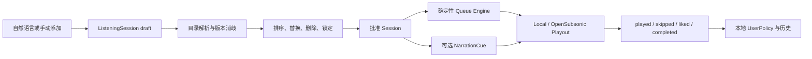

# Claudio 私人聆听会话：产品旁审与实施决策

> **历史决策快照，非当前实施依据。** 自 2026-10-16 起，产品范围、实施顺序、闸门和进度只在 [Claudio 统一实施方案](CLAUDIO_IMPLEMENTATION_PLAN.zh-CN.md) 维护。下文“当前”、Phase、时间估算及限制均保留为 2026-08-15 的原始判断，不构成额外审批要求；本地/OpenSubsonic 顺序与视觉限制已在统一方案中改写。
>
> 原始状态：个人版产品决策（待真实使用验证）
>
> 证据截止：2026-08-15（Pacific/Auckland）
>
> 适用范围：开源、自用、单用户、非推流、非公共广播
>
> 文档性质：产品边界、架构方向、实施顺序与停止条件；不是已完成功能声明

## 1. 决策摘要

旁审结论是：**有条件值得做，但不能把“精确点歌”单独当成产品，也不能重新扩张成大型 AI Radio 或音乐平台。**

当前最合理的产品定义是：

> **Claudio Personal Listening Session**：用户掌控一次聆听会话中的歌曲、顺序和约束；AI 可以理解意图、提出候选、填补空位和生成串词，但不能擅自替换已锁定歌曲。

三个看似不同的入口应统一为同一个 `ListeningSession`：

- 精确点歌：向会话插入一个已锁定的 `SessionItem`；
- 节目单：在播放前查看、排序、替换、删除并批准 draft；
- Radio：当队列低于阈值时，依据 `UserPolicy` 延迟追加候选，而不是另一套产品；
- DJ 主持：只为已经锁定的曲目生成可选 `NarrationCue`，不拥有选歌权。

这条路线比“另一个 Spotify DJ”更窄，但对个人工具来说，窄不是缺点。它只有在真实使用中明显优于“直接打开 Spotify、Navidrome 或 Plexamp”时才继续扩张。

## 2. 旁审：实用性、适用性与跑偏风险

### 2.1 实用性判断

| 维度 | 结论 | 依据 |
| --- | --- | --- |
| 工程可行性 | 高 | 仓库已有精确点歌、插队、歌单、锁定 `songId`、队列和播放状态 |
| 个人日常价值 | 中，未验证 | 主动编排场景有价值；纯休闲收听时，审批流程可能比 Spotify 更麻烦 |
| 差异化 | 有条件成立 | 依赖本地/自托管曲库、可编辑规则、人设和确定性队列；普通推荐并不稀缺 |
| 维护成本 | 中 | 模块化单体可控；若继续维护多平台播放源、设备和协议，成本会迅速上升 |
| 大众市场宽度 | 低 | 不追求大众播放器；对个人开源项目不是否决条件 |

### 2.2 什么情况下会过窄

以下定义过窄，不值得单独开发：

- “用聊天框播放一首指定歌曲”：普通播放器搜索和语音助手已经能完成；
- “让 AI 生成一个歌单”：Spotify Prompted Playlist、Plexamp、AudioMuse-AI 和智能歌单已有大量覆盖；
- “让 AI DJ 说话”：声音和串词是表现层，不足以构成长期价值；
- “做一个更小的 Spotify”：曲库、发现算法、跨端同步和零配置体验无法正面竞争。

### 2.3 为什么统一后的方向不算跑偏

`ListeningSession` 是可扩展但仍有边界的产品原语：

- 全部条目由用户指定时，它是确定性节目单；
- 一部分指定、一部分按约束填充时，它是协作式编排；
- 全部由规则生成时，它表现为 Radio；
- 串词关闭时，它仍是有用的会话播放器；
- 更换曲库或播放器时，核心计划和规则仍能复用。

因此 Claudio 不是围绕一个按钮建立产品，而是围绕“一次有状态、可审阅、可执行的聆听会话”建立产品。

### 2.4 最大失败条件

真正的风险不是技术做不出来，而是：

1. 用户最终仍然只点击 Spotify DJ 或现有歌单；
2. 每次审批节目单的摩擦高于收益；
3. 本地曲库规模或 metadata 不足，准确选歌和自动填充质量太低；
4. 串词在新鲜感消失后长期关闭；
5. 主要价值退化成“聊天输入代替搜索框”。

这些风险必须用短期真实使用验证，而不是用更多架构或功能规避。

## 3. 产品边界

### 3.1 目标用户

首要用户就是项目维护者本人，以及具有类似条件的开源爱好者：

- 有本地、Navidrome/OpenSubsonic 或特殊来源曲库；
- 喜欢主动安排一段工作、通勤、夜晚或主题收听；
- 希望中文/双语人设、声音和串词频率可以修改；
- 重视数据归属、推荐可解释性和规则可调整；
- 接受自行配置本地服务、模型或 TTS。

### 3.2 不适用人群

- 只想零配置、打开就听的普通用户；
- 主要需求是最大商业曲库和顶级发现算法的用户；
- 只使用 Spotify、且不愿维护本地或自托管曲库的用户；
- 需要多用户、家庭共享、跨房间同步或商业广播的人；
- 把中文 AI 串词当作唯一价值的人。

### 3.3 明确非目标

- 不推流，不做公共电台或广播 automation；
- 不做 OBS、VTuber、Live OS、硬件、支付、fleet 或 Locus 实时控制；
- 不建立全球音乐版权与使用报告系统；
- 不复制 Navidrome 的曲库、转码、账户和多端生态；
- 不复制 Music Assistant 的设备、音箱和多房间控制；
- 不把 Spotify 音频拉入 Claudio mixer，也不在 Spotify 音频上叠加 TTS；
- 不拆微服务，不为想象中的第三方消费者提前发布 npm 包。

## 4. 一个统一模型，而不是三个产品

### 4.1 核心对象

```ts
type ListeningSession = {
  id: string;
  state: "draft" | "approved" | "playing" | "completed" | "cancelled";
  targetDurationMs?: number;
  narrationMode: "off" | "brief" | "full";
  items: SessionItem[];
  policySnapshot: UserPolicy;
};

type SessionItem = {
  id: string;
  position: number;
  origin: "user" | "rule" | "ai_proposal";
  lock: "locked" | "replaceable";
  trackRef?: TrackRef;
  constraints?: TrackConstraints;
  narration?: NarrationCue;
};
```

文档中的类型是方向性 contract，不代表当前代码已经具备这些字段。

### 4.2 三种使用方式只是预设

| 使用方式 | Session 形态 | AI 权限 |
| --- | --- | --- |
| 立即点歌 | 一个 `locked` item，批准后立即播放 | 解析和消歧；不能换歌 |
| 计划一段会话 | `locked` 与 `replaceable` items 混合 | 只填空、提出替换建议 |
| 自动续播 | 队列低于阈值后追加 `replaceable` item | 按冻结的 policy 选择候选 |

Radio 不需要单独维护一套队列和状态。它只是 `ListeningSession` 的补充策略。

### 4.3 核心不变量

1. 用户锁定的 `TrackRef` 未经明确操作不得变化；
2. 歌曲有多个可能版本时必须停下来消歧，不能静默猜测；
3. `approved` 之后的变更必须成为明确的队列操作并记录原因；
4. Narration 只能引用当前锁定曲目和允许的上下文；
5. 模型不可直接调用播放器，不拥有播放真相；
6. 模型不可用时，点歌、编辑和播放仍然可用；
7. 播放源不可用时必须显示失败，不以另一首歌冒充成功。

## 5. 端到端体验

### 5.1 主流程

示例输入：

> 先播孙燕姿《遇见》，第二首周杰伦《晴天》，再补三首类似的，但不要五月天；控制在 25 分钟，串词简短。

系统应先生成 draft：

1. 孙燕姿《遇见》——用户指定、已锁定；
2. 周杰伦《晴天》——用户指定、已锁定；
3. 候选 A——AI 提议、可替换；
4. 候选 B——AI 提议、可替换；
5. 候选 C——AI 提议、可替换。

用户可以拖动、删除、搜索替换、锁定或解除锁定，然后批准播放。



### 5.2 播放中的控制

自然语言和 UI 操作应映射成同一组确定性命令：

- “把《红豆》放到下一首” → `insertAfterCurrent`；
- “第三首不要了” → `removeItem`；
- “把第二、第三首换一下” → `moveItem`；
- “后面少一点人声” → 只修改未锁定 item 的 constraint；
- “不要再自动补歌” → 关闭 auto-fill；
- “接下来别说话” → `narrationMode = off`。

聊天是快捷输入，不是唯一控制面。所有关键动作都必须有可见按钮和可撤销结果。

### 5.3 默认摩擦控制

- 单首精确点歌可一键播放，不强制完整审批页；
- 多曲计划先进入 draft；
- 已保存的个人场景可以一键批准；
- Radio 续补默认延迟发生，并允许关闭；
- 串词默认 `brief`，每 3–5 首或场景变化时才出现，而不是每首都说。

## 6. 适用场景矩阵

| 场景 | 价值 | 建议 |
| --- | --- | --- |
| 明确知道想听哪几首，并希望自动补齐 | 高 | 核心场景 |
| 25–90 分钟工作、通勤、夜晚或主题会话 | 高 | 核心场景 |
| 从个人曲库重找冷门或久未播放歌曲 | 中高 | 依赖历史与 metadata |
| 只想随机听点合适的歌 | 低至中 | 现有 Spotify/Plexamp 更方便 |
| 只想播放一首明确歌曲 | 低 | 必备基础能力，不是产品差异 |
| 多房间、家庭音箱和设备同步 | 低 | 交给 Music Assistant/Lyrion |
| 公共直播或网络电台 | 不适用 | 明确不做 |

## 7. 与现成产品的边界

### 7.1 Spotify

- 普通 Spotify 搜索和 Premium 播放可以精确选择单曲；Claudio 不以此为差异；
- Spotify DJ 官方主要描述按艺人、风格、情绪或活动改变个性化 session，而不是逐曲、逐位置锁定的节目单编辑器；
- Prompted Playlist 已能根据自然语言和完整收听历史生成、刷新歌单，显著压缩“AI 生成歌单”的差异；
- 因此 Claudio 的缺口只能是：**用户指定与 AI 提议共同组成一个可审阅、可锁定、可执行的 Session**。

官方资料：

- [Spotify DJ requests](https://newsroom.spotify.com/2025-05-13/dj-voice-requests/)
- [Spotify DJ text requests](https://newsroom.spotify.com/2025-10-15/dj-spanish-text-requests-update/)
- [Prompted Playlist](https://newsroom.spotify.com/2026-01-22/prompted-playlists-expansion/)
- [Spotify developer compliance tips](https://developer.spotify.com/compliance-tips)

### 7.2 本地与自托管生态

- [Navidrome](https://www.navidrome.org/docs/overview/) 已负责扫描、metadata、转码、歌单、多端客户端和 OpenSubsonic；
- [OpenSubsonic API](https://opensubsonic.netlify.app/docs/opensubsonic-api/) 可以作为默认目录与播放 contract；
- [Music Assistant](https://www.home-assistant.io/integrations/music_assistant/) 已负责 provider、player、队列迁移、设备和 announcement；
- [Plexamp](https://www.plex.tv/plexamp/) 已有个人曲库 Radio、sonic similarity 和 Guest DJ；
- [AudioMuse-AI](https://github.com/NeptuneHub/AudioMuse-AI) 已覆盖本地音频分析、相似性和音乐地图等能力。

Claudio 应复用协议和服务，不复制这些项目的基础设施或模型分析能力。

## 8. 推荐架构：模块化单体

### 8.1 业务核心

| 模块 | 内聚职责 |
| --- | --- |
| `SessionPlanner` | 创建 draft、填空、时长与约束检查 |
| `SessionEditor` | 插入、移动、删除、锁定、替换、批准 |
| `QueueEngine` | 执行 approved session、推进和自动续补 |
| `RecommendationCore` | 为未锁定位置排序候选、冷却和多样性 |
| `NarrationService` | 为锁定曲目生成、校验和缓存可选串词 |
| `ListeningHistory` | 播放、跳过、喜欢和会话完成事件 |

### 8.2 Ports

| Port | 作用 |
| --- | --- |
| `CatalogSearchPort` | 搜索并返回标准化 `TrackRef` |
| `MediaResolverPort` | 将 `TrackRef` 解析为可播放来源 |
| `SessionRepository` | 保存 session、item、版本和状态 |
| `HistoryRepository` | 保存播放与反馈事件 |
| `PlayoutPort` | 播放、暂停、跳过和读取进度 |
| `SpeechPort` | 可选 TTS，不参与选歌 |

### 8.3 Adapters

- 本地文件或 OpenSubsonic：默认主路径；
- KuGou：可关闭的 legacy adapter，不再决定产品身份；
- MusicBrainz：可选 metadata enrichment，不提供播放权；
- Fish/browser voice：可选语音 adapter；
- Spotify：只考虑播放列表或链接交接，音频留在官方播放器。

所有模块仍在一个仓库和进程中演进。只有出现至少两个真实、独立消费者，并且复制成本明显高于 contract 维护成本时，才考虑独立 package。

## 9. 当前仓库的可复用基础与缺口

### 9.1 已有基础

**[已证实]** 当前代码已有：

- 精确点歌文本解析、曲目排序与歧义保护：[`server/direct.ts`](server/direct.ts)；
- “播放现在”与“插入下一首”意图：[`server/chat.ts`](server/chat.ts)；
- 多曲歌单生成与浏览器队列：[`server/radio.ts`](server/radio.ts)、[`src/App.tsx`](src/App.tsx)；
- 点击队列中的确定曲目播放：[`src/components/PlaylistQueue.tsx`](src/components/PlaylistQueue.tsx)；
- 锁定 `songId` 并拒绝模型换歌：[`server/dj-contract.ts`](server/dj-contract.ts)；
- 推荐评分、近期冷却、品味和审计记录；
- 已建立 `CatalogSearchPort` 和 provider DTO mapper 的最小边界；
- Track persistence record 与 public DTO 的白名单边界。

### 9.2 关键缺口

**[已证实]** 当前还没有完整的 `ListeningSession`：

- KuGou 曲目存在时，`preferApiCatalog()` 会排除本地候选；
- `resolvePlaybackSource()` 对本地 track 仍然请求 KuGou；
- 多曲请求会直接成为 active playlist，没有 draft/approve 状态；
- 队列 UI 可以选择歌曲，但不能拖动、删除、替换或锁定；
- 一条输入尚不能稳定解析“指定曲目 + 顺序 + 空位 + 排除 + 时长”；
- 歧义候选主要以文字返回，缺少可操作候选卡片；
- 推荐审计、品味训练和串词反馈没有形成完整的可见闭环；
- 播放状态仍主要由 React `App.tsx` 持有，尚未形成可独立测试的 Queue Engine。

### 9.3 先保留的现有改造

- `CatalogSearchPort` 与 KuGou adapter mapper；
- `TrackRecord -> TrackDto` 显式白名单；
- public search 禁止查询文件系统 locator；
- Now Playing source 修复；
- 当前 contract tests 与负向测试。

这些改造正好支持 provider 可替换和 session 边界，与广播方向无关。

## 10. 国际/海外适配的实际含义

在个人自用范围内，“适应国外”不等于再接 Spotify、Apple Music、YouTube 和 SoundCloud 四套音频 API，也不需要全球广播权利系统。

第一版只需要：

1. OpenSubsonic/Navidrome 作为 provider-neutral 主目录；
2. locale、时区、语言和 TTS voice 可配置；
3. 中文、英文或双语人设可替换；
4. MusicBrainz 作为可选 metadata enrichment；
5. KuGou 作为 legacy adapter 可完全关闭；
6. Spotify 只做数据导入、playlist handoff 或 deep link 时，遵循官方平台政策。

OpenSubsonic 扩展必须做 capability discovery；缺少 sonic similarity 等扩展时，退回普通搜索、收藏、历史和规则选歌，不能假定所有服务器能力相同。

## 11. 历史实施顺序（已由统一方案替代）

### Phase 0：文档与边界（原阶段）

- 确认 `ListeningSession` 为唯一产品核心；
- 将 Sidecar、OBS、Live OS 和公共广播路线标记为非当前路线；
- 保留已有目录/DTO 安全边界；
- 不再增加新的 provider 或未来 Port。

### Phase 1：3–5 天纵向切片

只实现一条完整路径：

1. 本地/OpenSubsonic 为第一目录和播放来源；
2. 创建 `draft -> approved -> playing -> completed` session；
3. 支持精确添加一首、插入下一首、删除和移动；
4. 多曲计划播放前必须可见并批准；
5. 明确显示锁定与可替换状态；
6. narration 仅提供 `off / brief`，默认 brief；
7. 模型不可用时，手动编辑和播放仍然可完成。

暂不做复杂的多意图自然语言解析；先让确定性 UI 和 session 状态正确。

### Phase 2：7 天个人验证

- 使用至少 3 天；
- 完成至少 10 个 session；
- 覆盖精确点歌、混合节目单和自动续播；
- 记录点歌成功、修改数量、审批时间、跳过、串词关闭和回看行为；
- 与“直接使用 Spotify/Navidrome”做真实选择对比。

### Phase 3：只在通过闸门后增强

- 一句话解析多首锁定歌曲与约束位置；
- 可操作的消歧卡片；
- 保存个人 Session 模板；
- “为什么是这首”的三项主要理由；
- 串词批准/拒绝闭环；
- Spotify 历史导入或 playlist handoff；
- 按真实设备需求增加一个 `PlayoutPort` adapter。

### 暂不进入

- 微服务、独立 npm packages；
- 多用户与权限系统；
- 多平台实时播放聚合；
- 设备组、多房间和家庭自动化；
- OBS、广播、支付、硬件和 Live OS；
- embedding、声学分析和第二套 metadata 平台；
- 为展示增加 3D 角色、粒子或非核心视觉效果。

## 12. 验收与继续条件

### 12.1 工程验收

1. 50 次已知曲库的真实点歌，正确解析率至少 95%；
2. 歧义请求必须确认，错误静默替换为 0；
3. 锁定 item 在任何 AI 路径中都不能改变；
4. 插入、删除、移动、替换有确定结果和自动化测试；
5. session 刷新或重新打开后能恢复状态；
6. 模型、TTS 或 KuGou 不可用时，本地 session 仍可编辑和播放；
7. public API 不暴露文件路径、provider raw DTO 或内部凭据。

### 12.2 产品验证

建议用行为而非“感觉不错”作为闸门：

- 一周主动使用至少 3 天；
- 至少完成 10 个 session；
- 10 首 session 平均手动替换不超过 2 首；
- 从输入到批准的中位时间少于 2 分钟；
- 至少一半可比较场景主动选择 Claudio，而不是直接使用现有播放器；
- narration 保留或重听率至少 30%；低于该值则默认关闭，不再为 TTS 扩张；
- 自动续播的明显重复率低于 10%。

这些数字是首轮产品闸门，不是长期 KPI，也不是已达到的结果。

## 13. 停止与收缩条件

满足任何一项，应停止新增功能并重新判断：

- 真实点歌长期无法达到 95%，曲库或 provider 无法保证确定性；
- 多数 session 都跳过审阅，说明 draft 流程没有价值；
- 用户一周使用少于 3 天，且持续优先打开 Spotify/Plexamp；
- 串词长期关闭，继续增加 TTS、人设和声音没有依据；
- 主要用法退化成播放单首歌曲，普通播放器已经更快；
- 为支持播放不得不维护多个脆弱的非官方 provider；
- 新需求主要转向多用户、公共广播或设备平台，超出个人工具边界。

收缩后的合理终态可以只是一个完成度良好的开源实验：保留可运行 Demo、架构边界、测试和设计记录，不以功能数量证明价值。

## 14. 2026-08-15 决定快照

1. Claudio 当前主线是个人 `ListeningSession`，不是广播 Sidecar；
2. 单独的精确点歌是基础能力，不是产品定位；
3. 节目单、混合填空和 Radio 统一为一个 session/queue 模型；
4. 用户锁定歌曲与顺序，AI 只能提议和表达；
5. 第一主路径采用本地/OpenSubsonic，KuGou 降为可选 legacy adapter；
6. 复用 Navidrome/Music Assistant/Plexamp 生态，不复制媒体基础设施；
7. 先做 3–5 天纵向切片和 7 天个人验证；
8. 未通过行为闸门，不进入新的 provider、设备、视觉或未来架构；
9. Sidecar、OBS、Live OS、公共广播和全球权利系统全部暂停；
10. 未来方向由真实 session 使用证据决定，而不是由计划书完整度决定。

## 15. 原文档维护规则（已停止生效）

本节仅保留历史记录。未来路线、待办与实施状态只更新 [统一实施方案](CLAUDIO_IMPLEMENTATION_PLAN.zh-CN.md)，不再要求同步维护本文件的 Phase 或决策表。

- 用 **[已证实] / [推断] / [未来项]** 区分当前实现和目标；
- 平台能力、API 与政策每次实施前重查官方资料；
- 测试通过只证明工程状态，不证明个人使用价值；
- 原规则要求路线变更同步本文件、README 和历史方向文档；该多文件同步规则已于 2026-10-16 被统一方案维护规则替代；
- 不把 provider API 可用升级为音频权利、长期稳定性或产品必要性的证明。
